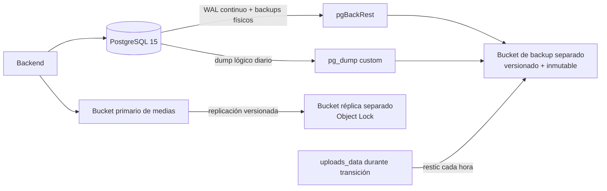

---
tags:
  - backend
  - infraestructura
  - backup
  - disaster-recovery
aliases:
  - Backup y Recuperación
  - Disaster Recovery
verified: 2026-10-26

---

# Backend — Backup y Recuperación

> [!important] Estado
> **Estrategia aprobada, todavía no implementada.** No se debe afirmar que Solennix tiene respaldos automáticos hasta completar los controles de aceptación de este documento.

Este documento define cómo proteger y recuperar PostgreSQL, archivos multimedia y configuración operativa. La prioridad es eliminar el riesgo actual de pérdida total por falla, borrado o compromiso del VPS.

**Relacionado:** [[Backend MOC]] | [[Base de Datos]] | [[Despliegue]] | [[Seguridad]]

---

## Implementación urgente

1. Crear un bucket de respaldo en una cuenta o proyecto separado del VPS.
2. Activar cifrado, versionado y retención inmutable de 30 días.
3. Programar `pg_dump` diario y respaldo horario de `uploads_data`.
4. Alertar si un trabajo no termina correctamente dentro de su ventana.
5. Restaurar ambos respaldos en un entorno aislado y guardar evidencia.
6. Recién entonces comunicar públicamente que existen respaldos automáticos.

> [!danger] Un volumen no es un backup
> Los volúmenes externos `solennix_db_data` y `solennix_uploads_data` sobreviven a la recreación de contenedores, pero siguen en el mismo VPS. No protegen contra pérdida del host, corrupción, ransomware ni errores administrativos.

---

## Objetivos de recuperación

| Activo | RPO máximo | RTO objetivo | Prioridad |
| --- | ---: | ---: | --- |
| PostgreSQL | 5 min | 2 h | P0 |
| Medias | 1 h | 4 h | P0 |
| Configuración operativa | 24 h | 4 h | P1 |

- **RPO**: cantidad máxima de datos que se acepta perder.
- **RTO**: tiempo objetivo para restablecer el servicio.
- Los objetivos empiezan a contar cuando el incidente es declarado.

## Principios obligatorios

- Aplicar **3-2-1-1-0**: 3 copias, 2 medios, 1 copia externa, 1 copia inmutable y 0 errores verificados.
- Separar producción y respaldos por cuenta, credenciales y permisos.
- Cifrar en tránsito y en reposo; las claves no se guardan junto al respaldo.
- Preferir restauraciones a entornos nuevos. Nunca probar sobre producción.
- Tratar replicación, snapshots y volúmenes como controles complementarios, no como reemplazo de un backup.
- Un backup solo cuenta como válido después de una restauración comprobada.

---

## Arquitectura objetivo



### Decisiones

| Área | Decisión | Motivo |
| --- | --- | --- |
| PostgreSQL físico | `pgBackRest` con archivado continuo de WAL | Permite Point-in-Time Recovery y controla retención, cifrado y verificación. |
| PostgreSQL lógico | `pg_dump -Fc` diario + globals | Agrega portabilidad y restauración selectiva; no reemplaza PITR. |
| Medias actuales | `restic` horario desde `uploads_data` | Reduce el riesgo mientras las medias permanezcan en el VPS. |
| Medias objetivo | S3-compatible primario, versionado y réplica inmutable | Separa las medias del ciclo de vida del VPS y protege versiones anteriores. |
| Destino | Object storage en cuenta/proyecto separado | Una credencial comprometida de producción no debe poder borrar respaldos. |

> [!warning] PostgreSQL en ejecución
> No copiar directamente `/var/lib/postgresql/data` con `tar`, `rsync` o un backup genérico mientras PostgreSQL está activo. Usar `pgBackRest`, `pg_basebackup` o un snapshot consistente coordinado con PostgreSQL.

---

## Política de PostgreSQL

### Capas de protección

1. **WAL continuo**: enviar cada segmento al repositorio remoto mediante `archive_command`.
2. **Backup físico**: completo semanal y diferencial diario con `pgBackRest`.
3. **Dump lógico**: exportación diaria en formato custom y exportación de roles/globales.
4. **Verificación**: `pgBackRest check`, validación del dump y restauración automatizada.

La imagen actual `postgres:15-alpine` no incluye `pgBackRest`. La implementación de PITR debe crear una imagen de PostgreSQL versionada que instale el binario y su configuración. No ejecutar WAL archiving desde un contenedor efímero sin acceso controlado a `PGDATA`.

### Retención

| Artefacto | Frecuencia | Retención |
| --- | --- | --- |
| WAL | Continua | Ventana PITR de 30 días |
| Backup físico completo | Semanal | 5 completos |
| Backup físico diferencial | Diario | Hasta expirar con su backup completo |
| Dump lógico custom | Diario | 30 días |
| Dump lógico mensual | Mensual | 12 meses |
| Roles/globales | Diario y ante cambios | 30 días |

### Dump lógico de contingencia

Ejecutar desde el VPS con credenciales obtenidas en runtime. No incluir passwords en el comando, logs ni nombres de archivo. El flujo recomendado transmite el dump directamente al repositorio cifrado para no dejar una copia en texto plano en el disco del VPS.

```bash
set -euo pipefail
timestamp="$(date -u +%Y%m%dT%H%M%SZ)"
docker exec solennix-db pg_dump -U solennix_user -d solennix -Fc \
  | restic backup --stdin \
      --stdin-filename "postgres/logical/solennix-${timestamp}.dump"
docker exec solennix-db pg_dumpall -U solennix_user --globals-only \
  | restic backup --stdin \
      --stdin-filename "postgres/logical/solennix-globals-${timestamp}.sql"
```

Después de guardarlos:

- Comprobar que ambos objetos existen y no están vacíos.
- Recuperar el dump como stream y ejecutar `pg_restore --list`.
- Verificar el snapshot y su checksum desde el repositorio remoto.
- No crear copias temporales sin cifrar fuera de un filesystem temporal controlado.
- Emitir una métrica y una alerta si cualquier paso falla.

### Criterios de salud

- Último WAL archivado: menos de 5 minutos de atraso.
- Último backup diferencial/completo: menos de 26 horas.
- Último dump lógico: menos de 26 horas.
- `pgBackRest check`: exitoso.
- Última restauración automática: menos de 7 días.

---

## Política de medias

### Transición inmediata: volumen local

Hasta terminar la migración a object storage:

- Respaldar `solennix_uploads_data` cada hora con `restic`.
- Mantener snapshots horarios, diarios, semanales y mensuales.
- Ejecutar `restic check` semanalmente.
- Restaurar una muestra aleatoria semanal y validar checksum y decodificación.

Retención propuesta para restic:

| Snapshot | Retención |
| --- | ---: |
| Horario | 48 horas |
| Diario | 30 días |
| Semanal | 12 semanas |
| Mensual | 12 meses |

`restic` debe usar un password aleatorio almacenado en el gestor de secretos. Perder ese password equivale a perder todos los respaldos.

### Estado objetivo: object storage

El bucket primario debe tener:

- Acceso público bloqueado; exposición únicamente mediante CDN o URLs controladas.
- Cifrado administrado por KMS o equivalente.
- Versionado activado.
- Lifecycle para versiones no actuales.
- Inventario y alertas sobre fallas de replicación.

El bucket réplica debe estar en otra cuenta o proyecto y tener:

- Object Lock o retención WORM de 30 días.
- Cifrado con una clave independiente.
- Política que impida al rol de producción borrar objetos, versiones o retención.
- Replicación hacia una región distinta cuando el proveedor lo permita.

> [!warning] Fallback local
> En producción, un error al inicializar S3 no debe degradar silenciosamente a almacenamiento local. El backend debe fallar al arrancar o marcarse como no saludable; de otro modo las medias quedan divididas entre S3 y el VPS.

---

## Seguridad y acceso

| Identidad | Permisos permitidos | Permisos prohibidos |
| --- | --- | --- |
| Backend | Operar sobre el bucket primario de medias | Acceder al bucket de backup o modificar retención |
| Backup writer | Leer origen y crear backups | Borrar backups, desactivar versionado o saltar Object Lock |
| Verificador | Listar y leer backups para pruebas | Escribir o borrar |
| Restore operator | Lectura temporal mediante acceso break-glass | Acceso permanente |

Controles adicionales:

- MFA obligatoria para administradores.
- Credenciales de corta duración cuando el proveedor lo soporte.
- Auditoría de lectura, escritura, cambio de políticas y restauraciones.
- Rotación documentada de claves sin invalidar respaldos existentes.
- Copia cifrada del runbook y configuración; nunca respaldar `.env` en texto plano.
- Probar la recuperación de claves. Un backup cifrado sin su clave es irrecuperable.

---

## Runbook de restauración

### 1. Declarar y contener

1. Designar un responsable del incidente.
2. Detener escrituras si pueden empeorar la corrupción.
3. Preservar logs y evidencia.
4. Definir el punto objetivo de recuperación en UTC.
5. Revocar credenciales comprometidas antes de conectar el entorno recuperado.

### 2. Restaurar PostgreSQL con PITR

1. Crear host, volumen y red aislados.
2. Instalar la misma versión mayor de PostgreSQL y la versión compatible de `pgBackRest`.
3. Restaurar el último backup físico anterior al punto objetivo.
4. Reproducir WAL hasta el timestamp o transacción objetivo.
5. Iniciar PostgreSQL sin tráfico público.
6. Validar esquema, migraciones, usuarios, conteos y relaciones críticas.
7. Ejecutar pruebas de lectura y escritura con una copia del backend.
8. Registrar duración, punto recuperado y evidencia.

### 3. Restaurar desde dump lógico

Usar esta vía para portabilidad, recuperación selectiva o cuando PITR no sea necesario:

```bash
createdb solennix_restore
psql -d postgres -f solennix-globals-<timestamp>.sql
pg_restore --exit-on-error --no-owner -d solennix_restore \
  solennix-<timestamp>.dump
```

El dump proviene de una fuente con capacidad de ejecutar definiciones SQL. Solo se restaura después de validar su procedencia e integridad.

### 4. Restaurar medias

- Seleccionar el snapshot o versiones alineadas con el punto recuperado de PostgreSQL.
- Restaurar primero en un prefijo o bucket nuevo.
- Validar checksums, cantidad de objetos y decodificación de una muestra.
- Ejecutar reconciliación para detectar referencias sin objeto y objetos huérfanos.
- Cambiar el backend/CDN al destino recuperado solo después de validar.

### 5. Volver a servicio

1. Crear un backup de la recuperación antes de abrir tráfico.
2. Rotar todas las credenciales del entorno afectado.
3. Habilitar tráfico gradualmente.
4. Vigilar errores, latencia y consistencia durante 24 horas.
5. Completar postmortem y corregir el runbook.

---

## Pruebas y evidencia

| Prueba | Frecuencia | Evidencia mínima |
| --- | --- | --- |
| Validación de job y checksum | Cada ejecución | Estado, timestamp, tamaño y checksum |
| Restauración PostgreSQL automatizada | Semanal | Logs, duración, migración y smoke tests |
| Restauración de muestra de medias | Semanal | Objetos elegidos, checksum y decode |
| Simulacro completo de desastre | Trimestral | RPO/RTO medidos, hallazgos y responsables |
| Revisión de permisos y retención | Trimestral | Export de políticas y aprobación |

Un job exitoso que nunca fue restaurado es solo una **esperanza**, no evidencia de recuperación.

## Alertas obligatorias

- No hubo backup dentro de su ventana.
- WAL no se archiva o supera 5 minutos de atraso.
- El tamaño cambia de forma anómala respecto de ejecuciones anteriores.
- Fallan checksum, `pgBackRest check`, `restic check` o restore test.
- Se cambia versionado, Object Lock, lifecycle, KMS o permisos.
- La replicación de medias acumula objetos pendientes o fallidos.

Las alertas P0 deben llegar a un canal externo al VPS.

---

## Plan de implementación

### P0 — Protección mínima, 24 horas

- [ ] Crear cuenta/proyecto y bucket de backup separados.
- [ ] Configurar cifrado, versionado y retención inmutable de 30 días.
- [ ] Automatizar dump lógico diario y globals.
- [ ] Automatizar restic horario para `uploads_data`.
- [ ] Configurar alertas de éxito ausente y fallo.
- [ ] Ejecutar y documentar la primera restauración aislada.

### P1 — RPO objetivo, 7 días

- [ ] Construir imagen PostgreSQL 15 con `pgBackRest`.
- [ ] Activar WAL archiving, backups full/diff y PITR de 30 días.
- [ ] Migrar medias primarias a S3-compatible.
- [ ] Eliminar el fallback silencioso de S3 a disco local en producción.
- [ ] Configurar bucket réplica con Object Lock.

### P2 — Operación sostenible, 30 días

- [ ] Automatizar restauración semanal y smoke tests.
- [ ] Crear dashboard de edad, tamaño, duración y fallos.
- [ ] Ejecutar el primer simulacro completo y medir RPO/RTO.
- [ ] Revisar costos y ajustar lifecycle sin reducir la ventana aprobada.
- [ ] Alinear textos públicos con controles realmente verificados.

## Gate para declarar “backups automáticos”

La afirmación solo está permitida cuando TODOS estos puntos están comprobados:

- [ ] PostgreSQL y medias tienen jobs automáticos activos.
- [ ] Existe al menos una copia fuera del VPS.
- [ ] Existe una copia inmutable con retención vigente.
- [ ] Fallos y ausencia de ejecución generan alertas.
- [ ] Una restauración completa terminó correctamente.
- [ ] Se registraron RPO y RTO reales.
- [ ] Hay responsable y fecha de la próxima prueba.

---

## Referencias

- [PostgreSQL — Backup and Restore](https://www.postgresql.org/docs/15/backup.html)
- [PostgreSQL — Continuous Archiving and PITR](https://www.postgresql.org/docs/15/continuous-archiving.html)
- [PostgreSQL — pg_dump](https://www.postgresql.org/docs/15/app-pgdump.html)
- [pgBackRest User Guide](https://pgbackrest.org/user-guide.html)
- [restic Documentation](https://restic.readthedocs.io/en/stable/)
- [Amazon S3 Object Lock](https://docs.aws.amazon.com/AmazonS3/latest/userguide/object-lock.html)
