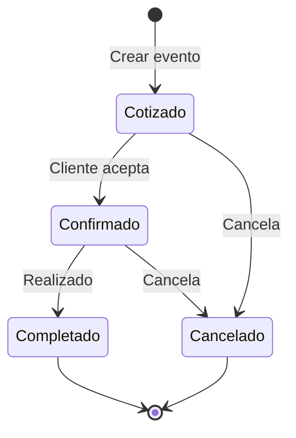

---
tags:
  - prd
  - features
  - paridad
  - solennix
aliases:
  - Catálogo de Features
  - Features
date: 2026-03-20
updated: 2026-08-05
status: active
---

# Solennix — Catálogo de Features

**Version:** 2.0  
**Actualizado:** 2026-08-05  
**Plataformas:** iOS · Android · Web (React 19) · Backend (Go/PostgreSQL)  
**Estado:** Activo — matriz de paridad y producto (no changelog)

> [!tip] Documentos relacionados
>
> - [[04_MONETIZATION|Monetización]] v3.0 — precios, matriz de gating y billing
> - [[11_CURRENT_STATUS|Estado Actual]] — snapshot operativo
> - [[09_ROADMAP|Roadmap]] — Now / Next / Later
> - [[15_MARKETPLACE_V2|v2.0 Discovery & Inbound]] — norte inbound (no marketplace)
> - Contrato API: `backend/docs/openapi.yaml`

---

## 1. Cómo usar este documento

| Necesitás | Dónde |
| :--- | :--- |
| ¿Existe la feature y en qué plataforma? | Secciones P0/P1 + **§12 Tabla de paridad** |
| ¿Qué plan la desbloquea? | **§2 Límites y gates** + [[04_MONETIZATION]] §0 |
| Detalle de implementación | MOC de plataforma (`docs/{iOS,Android,Web,Backend}/`) |
| Spec de un cambio grande | `openspec/changes/` |

**Reglas:**

1. Tiers de producto: **Gratis · Pro · Business** (UI). En API/DB: `basic` | `pro` | `business` (`free`/`premium` se normalizan a `basic`/`pro`).
2. Este doc **no** es changelog. Releases → `versioning/releases.json` + `CHANGELOG.md`.
3. Al shippear una feature: actualizar paridad aquí + gates en [[04_MONETIZATION]] si cambian límites.

### Leyenda de estados

| Símbolo | Significado |
| --- | --- |
| ✅ | Implementado |
| 🔄 | Parcial / residual |
| ⬜ | Pendiente |
| 📋 | Exploración (no comprometido) |
| ➖ | No aplica |

### Etiquetas de plataforma

**[Todas]** · **[iOS]** · **[Android]** · **[Web]** · **[Backend]** · **[Mobile]** (iOS+Android)

---

## 2. Límites y gates (código + producto)

> [!important] Fuente dual
> **Límites numéricos enforceados en backend** (tabla abajo) son la verdad de runtime.  
> **Matriz comercial completa** (portal branding, WhatsApp API, soporte, etc.) vive en [[04_MONETIZATION]] §0.2 y §0 bis.  
> Si diverge código vs monetization → **arreglar monetization o el código**; no dejar el gap silencioso.

### 2.1 Límites Gratis (`plan` normalizado = `basic`)

| Recurso | Límite (código) | Notas |
| :--- | ---: | :--- |
| Eventos / mes calendario | **4** | `COUNT` por `date_trunc('month', event_date)` |
| Clientes | **20** | |
| Productos | **15** | + techo compuesto catálogo |
| Inventario | **30** | + techo compuesto catálogo |
| Catálogo compuesto (productos + inventario) | **20** | Advisory lock `catalog` |
| Staff seats (filas en `staff`) | **1** | Pro = **2**; Business = ∞ |
| Links de solicitud activos | **3** | `public_request_links` activos no expirados |

Pro y Business: sin esos techos de escala (∞) salvo reglas de negocio puntuales (portfolio máx 6, etc.).

### 2.2 Gates de calidad / cara-al-cliente (resumen)

| Capability | Gratis | Pro | Business |
| :--- | :---: | :---: | :---: |
| Core ops (eventos, clientes, catálogo, pagos manuales, calendario) | ✓ (con límites) | ✓ | ✓ |
| Branding PDF / plantilla contrato editable | básico / default | ✓ completo | ✓ |
| Portal cliente (post-venta) | básico (footer Solennix) | full + branding | full |
| Payment submissions (cliente reporta transferencia) | — | ✓ | ✓ |
| Perfil público `/u/:slug` | básico (≤3 servicios; sin reviews/portfolio/socials) | full | full + **destacado directorio** |
| Portfolio / reviews públicas / socials / packages / FAQ | — | ✓ | ✓ |
| Email a colaborador al asignar | — | ✓ | ✓ |
| Login colaborador (team member portal) | — | — | ✓ (rol `team_member`) |
| Chart ingresos dashboard (server) | — | ✓ | ✓ |
| Listing destacado en directorio | — | — | ✓ (ranking featured) |

Detalle y precios → [[04_MONETIZATION]].

### 2.3 Ciclo de vida del evento

Estados API: `quoted` / `confirmed` / `completed` / `cancelled` (UI en español).

---

## 3. P0 — Core operativo

### 3.1 Eventos [Todas]

Módulo central: cotizar → confirmar → ejecutar → cerrar.

| Capacidad | iOS | Android | Web | Backend |
| :--- | :---: | :---: | :---: | :---: |
| Formulario multi-paso (general, productos, extras, equipo/insumos/staff, finanzas) | ✅ | ✅ | ✅ | ✅ |
| Estados + lista/filtros + detalle hub | ✅ | ✅ | ✅ | ✅ |
| Descuento global %/fijo, IVA, depósito, cancelación | ✅ | ✅ | ✅ | ✅ |
| Moneda por evento (`currency`, default user) | ✅ | ✅ | ✅ | ✅ |
| Galería de fotos | ✅ | ✅ | ✅ | ✅ |
| Conflictos de equipo + sugerencias equipo/insumos | ✅ | ✅ | ✅ | ✅ |
| Checklist del evento | ✅ | ✅ | ✅ | ➖ (client-side / PDF) |
| Unificación Eventos + Calendario (Lista \| Calendario) | ✅ | 🔄¹ | ✅ | ✅ |

¹ Android puede conservar superficies de calendario propias; iOS/Web unificaron en Eventos.

**Gate:** escala por plan (§2.1). Completar evento con saldo pendiente puede bloquearse en mobile.

---

### 3.2 Clientes [Todas]

| Capacidad | iOS | Android | Web | Backend |
| :--- | :---: | :---: | :---: | :---: |
| CRUD + búsqueda | ✅ | ✅ | ✅ | ✅ |
| Detalle + historial (`total_events`, `total_spent`) | ✅ | ✅ | ✅ | ✅ |
| Alta rápida desde evento | ✅ | ✅ | ✅ | ✅ |

**Gate:** Gratis ≤ 20 clientes.

> [!note] Stats
> `total_events` cuenta no-cancelados; `total_spent` sobre confirmados+completados (no solo completed).

---

### 3.3 Productos [Todas]

| Capacidad | iOS | Android | Web | Backend |
| :--- | :---: | :---: | :---: | :---: |
| CRUD, categoría, precio, imagen, activo | ✅ | ✅ | ✅ | ✅ |
| Recetas (insumos / equipo / por evento) | ✅ | ✅ | ✅ | ✅ |
| Equipo asociado (`staff_team_id` → expansión en evento) | ✅ | ✅ | ✅ | ✅ |
| Flag `show_on_public_profile` | ✅ | ✅ | ✅ | ✅ |
| KPIs / demanda en detalle | ✅ | ✅ | ✅ | ➖ |

**Gate:** Gratis ≤ 15 productos (+ catálogo compuesto). Free: máx 3 con `show_on_public_profile=true`.

---

### 3.4 Inventario [Todas]

| Capacidad | iOS | Android | Web | Backend |
| :--- | :---: | :---: | :---: | :---: |
| CRUD equipo/insumo/consumible + stock + mínimo + costo | ✅ | ✅ | ✅ | ✅ |
| Ajuste rápido de stock | ✅ | ✅ | ✅ | ✅ |
| Alertas de stock bajo / demanda | ✅ | ✅ | ✅ | ➖ |

**Gate:** Gratis ≤ 30 ítems (+ catálogo compuesto).

---

### 3.5 Calendario [Todas]

| Capacidad | iOS | Android | Web | Backend |
| :--- | :---: | :---: | :---: | :---: |
| Vista mensual + dots por estado | ✅ | ✅ | ✅ | ➖ |
| Fechas no disponibles (bloqueos) | ✅ | ✅ | ✅ | ✅ |
| Export iCal | ✅ | 🔄 | 🔄 | ✅ |
| Sync write-only al calendario del sistema (EventKit) | ✅ | ⬜ | ➖ | ➖ |

---

### 3.6 Autenticación [Todas]

| Capacidad | iOS | Android | Web | Backend |
| :--- | :---: | :---: | :---: | :---: |
| Email/password + refresh | ✅ | ✅ | ✅ | ✅ |
| Google Sign-In | ✅ | ✅ | ✅ | ✅ |
| Apple Sign-In | ✅ | ✅ | ✅ | ✅ |
| Forgot / reset / change password | ✅ | ✅ | ✅ | ✅ |
| Biometric unlock | ✅ | ✅ | ➖ | ➖ |
| Invitación / rol `team_member` | ✅ | ✅ | ✅ | ✅ |

---

### 3.7 Dashboard [Todas]

| Capacidad | iOS | Android | Web | Backend |
| :--- | :---: | :---: | :---: | :---: |
| KPIs del mes (server-side) | ✅ | ✅ | ✅ | ✅ |
| Alertas (stock, pagos, sin confirmar) | ✅ | ✅ | ✅ | ✅ |
| Próximos eventos + quick actions | ✅ | ✅ | ✅ | ✅ |
| Chart ingresos (serie) | ✅ | ✅ | ✅ | ✅ Pro+ |
| Onboarding checklist | ✅ | ✅ | ✅ | ➖ |
| Share perfil público (CTA) | 🔄 | 🔄 | ✅ | ➖ |

---

### 3.8 Pagos y finanzas [Todas]

> [!important] NG1
> Solennix **no intermedia** dinero organizador↔cliente. Los pagos son **registros manuales**. Stripe/App Store/Play = solo suscripción del organizador a Solennix.

| Capacidad | iOS | Android | Web | Backend |
| :--- | :---: | :---: | :---: | :---: |
| CRUD pagos manuales por evento | ✅ | ✅ | ✅ | ✅ |
| Balance / anticipo / métodos múltiples | ✅ | ✅ | ✅ | ✅ |
| Inbox: cliente reporta transferencia (`payment_submissions`) + approve/reject | ✅ | ✅ | ✅ | ✅ |
| Reportes PDF de pagos | ✅ | ✅ | ✅ | ✅ (server PDF) |

**Gate:** payment submissions cara-al-cliente = **Pro+** (ver monetization). Registro manual del organizador = todos los planes.

---

## 4. P1 — Producto, inbound y crecimiento

### 4.1 PDFs [Todas]

Generación **server-side** en Go (`backend/internal/pdf/`, rutas `/api/events/{id}/pdf/*` + quick quote `POST /api/pdf`).

| Documento | iOS | Android | Web | Backend |
| :--- | :---: | :---: | :---: | :---: |
| Presupuesto | ✅ | ✅ | ✅ | ✅ |
| Contrato (plantilla) | ✅ | ✅ | ✅ | ✅ |
| Lista de compras | ✅ | ✅ | ✅ | ✅ |
| Checklist | ✅ | ✅ | ✅ | ✅ |
| Lista de equipo | ✅ | ✅ | 🔄 | ✅ |
| Reporte de pagos | ✅ | ✅ | ✅ | ✅ |
| Quick quote PDF | ✅ | ✅ | ✅ | ✅ |

**Gate:** branding/plantilla editable = Pro+. Clientes pueden conservar generadores locales residuales → meta: consumir solo backend ([[20_SERVER_SIDE_PDF_GENERATION]]).

---

### 4.2 Búsqueda global [Todas]

Clientes + eventos + productos + inventario.

| Capacidad | iOS | Android | Web | Backend |
| :--- | :---: | :---: | :---: | :---: |
| Búsqueda in-app | ✅ (tab Search / role search iOS 26) | ✅ | ✅ (topbar + Cmd+K) | ✅ |
| Core Spotlight | ✅ | ➖ | ➖ | ➖ |

---

### 4.3 Cotización rápida [Todas]

Presupuesto sin evento completo; PDF vía backend. Entrada: FAB / acciones contextuales (no tab).

| iOS | Android | Web | Backend |
| :---: | :---: | :---: | :---: |
| ✅ | ✅ | ✅ | ✅ |

---

### 4.4 Widgets y Live Activity [Mobile]

| Capacidad | iOS | Android |
| :--- | :---: | :---: |
| Widget próximos eventos / acciones | ✅ | ✅ |
| Widget KPIs | ✅ | 🔄 |
| Lock Screen | ✅ | ➖ |
| Live Activity / Dynamic Island | ✅ | ⬜ |

---

### 4.5 Suscripciones y billing [Todas]

| Capacidad | iOS | Android | Web | Backend |
| :--- | :---: | :---: | :---: | :---: |
| Planes Gratis / Pro / Business | ✅ | ✅ | ✅ | ✅ |
| RevenueCat + StoreKit 2 fallback | ✅ | ✅ (Play/RC) | ➖ | ✅ webhooks |
| Stripe Checkout + Customer Portal | ➖ | ➖ | ✅ | ✅ |
| `GET /subscriptions/status` (`provider`, periods) | ✅ | ✅ | ✅ | ✅ |
| Enforcement límites server-side | ✅ | ✅ | ✅ | ✅ |
| UI paywall / UpgradeBanner | ✅ | ✅ | ✅ | ➖ |

Tiers y precios → [[04_MONETIZATION]].

---

### 4.6 Panel admin [Web] [Backend]

| Capacidad | Web | Backend |
| :--- | :---: | :---: |
| Stats plataforma (usuarios, planes, DAU/WAU/MAU, funnels) | ✅ | ✅ |
| Lista/detalle usuarios + search/plan + upgrade | ✅ | ✅ |
| Moderación de listings (approve/reject directorio) | ✅ | ✅ |
| Beacons públicos page-view / registration funnel | ✅ | ✅ |

**Gate:** solo rol admin.

---

### 4.7 Perfil profesional público [Todas + público Web]

Perfil opt-in del organizador en **`/u/:slug`**. No es marketplace: es landing del proveedor.

| Capacidad | iOS | Android | Web | Backend |
| :--- | :---: | :---: | :---: | :---: |
| Settings: enable, slug, headline, ubicación, contacto, `show_prices`, `service_radius_km` | ✅ | ✅ | ✅ | ✅ |
| Preview del perfil | ✅ | ✅ | ✅ | ✅ |
| Página pública shell-less | ➖ | ➖ | ✅ | ✅ |
| Servicios (productos con flag) | ✅ | ✅ | ✅ | ✅ |
| Portfolio (máx 6) | ✅ | ✅ | ✅ | ✅ Pro+ |
| Packages (per_guest / per_event, discount tiers, min_guests) | ✅ | ✅ | ✅ | ✅ Pro+ |
| FAQ / services extras | ✅ | ✅ | ✅ | ✅ |
| Reviews públicas sanitizadas | ➖ | ➖ | ✅ | ✅ Pro+ |
| Submit for directory review | 🔄 | 🔄 | ✅ | ✅ |
| CTA conversión (sticky, WhatsApp, package prefill) | ➖ | ➖ | ✅ | ✅ |

**Gate:** §2.2. Privacidad: sin PII de clientes en superficie pública.

API clave: `GET /api/public/organizers/{slug}`, `GET|PUT /api/users/me/public-profile`, portfolio/packages/faq CRUD.

---

### 4.8 Solicitudes (inbound unificado) [Todas]

> [!success] Reemplaza “Formularios compartibles” / EventFormLink / PublicLead
> Un solo dominio **`PublicRequest`**. Entradas: perfil `/u/:slug` y link `/s/:token`. Hub organizador: **Solicitudes** (inbox + links).

| Capacidad | iOS | Android | Web | Backend |
| :--- | :---: | :---: | :---: | :---: |
| Inbox organizador (list/detail, accept/decline, unread) | ✅ | ✅ | ✅ | ✅ |
| Links compartibles CRUD + revoke | ✅ | ✅ | ✅ | ✅ |
| Form público link `/s/:token` | ➖ | ➖ | ✅ | ✅ |
| Form en perfil + quote package | ➖ | ➖ | ✅ | ✅ |
| Status visitante `/solicitud/:id` (+ token) | ➖ | ➖ | ✅ | ✅ |
| Auto-event / re-quote / submit-info | 🔄 | 🔄 | ✅ | ✅ |
| Anti-spam (rate-limit + honeypot) | ➖ | ➖ | ✅ | ✅ |
| Captcha Turnstile | ⬜ | ⬜ | 🔄 | 🔄 |
| Push por outcome | ✅ | ✅ | ➖ | ✅ |

**Rutas API:**  
`/api/public/organizers/{slug}/requests`, `/api/public/request-links/...`, `/api/public/requests/{id}`, `/api/organizers/me/requests/*`, `/api/organizers/me/request-links/*`.

**Gate:** Gratis ≤ **3** links activos; Pro+ ilimitados.  
**Legacy:** rutas UI `/event-forms` pueden existir como redirect residual — dominio canónico = Solicitudes.

Spec: `openspec/changes/unify-solicitudes-forms/`.

---

### 4.9 Directorio y discovery [Web] [Backend]

| Capacidad | Web | Backend | Mobile |
| :--- | :---: | :---: | :---: |
| Listado `/providers` (legacy `/proveedores` → redirect) | ✅ | ✅ | ➖ |
| Search + filtros + sort relevance/rating/recent/distance | ✅ | ✅ | ➖ |
| Geo (`lat`, `lng`, `radius_km`) | ✅ | ✅ | ➖ |
| Featured ranking (Business+) | ✅ | ✅ | ➖ |
| Sitemap perfiles `sitemap-profiles.xml` | ✅ | ✅ | ➖ |
| SEO / robots | ✅ | ✅ | ➖ |

**Gate:** listado todos los planes publicables; **destacado = Business**. Norte producto: [[15_MARKETPLACE_V2]].

---

### 4.10 Portal del cliente (post-venta) [Todas]

Distinto de Solicitudes: es el portal **por evento** para el cliente final (read-only + reportar pago).

| Capacidad | iOS | Android | Web | Backend |
| :--- | :---: | :---: | :---: | :---: |
| Crear/rotar/revocar link por evento | ✅ | ✅ | ✅ | ✅ |
| Portal `/client/:token` | ➖ | ➖ | ✅ | ✅ |
| Share nativo (WhatsApp, etc.) | ✅ | ✅ | ✅ | ➖ |
| Balance / payment summary (shape por plan) | ➖ | ➖ | ✅ | ✅ |
| Cliente registra transferencia + inbox org | ✅ | ✅ | ✅ | ✅ |

**Gate:** Gratis = portal básico; Pro+ branding + payment features. Ver [[04_MONETIZATION]] §0.2.

---

### 4.11 Personal / colaboradores [Todas]

| Capacidad | iOS | Android | Web | Backend | Gate |
| :--- | :---: | :---: | :---: | :---: | :--- |
| CRUD staff + asignar a evento + fee | ✅ | ✅ | ✅ | ✅ | seats §2.1 |
| Turnos + RSVP + disponibilidad | ✅ | ✅ | ✅ | ✅ | todos |
| Equipos (teams) + expandir a evento | ✅ | ✅ | ✅ | ✅ | todos |
| Producto con `staff_team_id` | ✅ | ✅ | ✅ | ✅ | todos |
| Email al asignar (Resend) | ✅ | ✅ | ✅ | ✅ | **Pro+** |
| Portal team member (Mi jornada + calendario) | ✅ | ✅ | ✅ | ✅ | **Business** (login) |

---

### 4.12 Inbound analytics [Web] [Backend]

| Capacidad | Web | Backend | Mobile |
| :--- | :---: | :---: | :---: |
| `GET /api/users/me/inbound-analytics` (views + requests funnel) | ✅ | ✅ | ⬜ |
| UI `/inbound` (o settings) | ✅ | ➖ | ⬜ |

**Gate:** sin techo documentado en mon. §0 — alinear en pase de monetization (¿Gratis básico / Pro full?).

---

### 4.13 Multi-moneda y i18n [Todas]

| Capacidad | iOS | Android | Web | Backend |
| :--- | :---: | :---: | :---: | :---: |
| `default_currency` usuario + `currency` evento | ✅ | ✅ | ✅ | ✅ |
| Formatters dinámicos (no hardcode MXN) | ✅ | ✅ | ✅ | ✅ (PDF) |
| UI ES + EN (device/navigator locale) | ✅ | ✅ | ✅ | ✅ mensajes |
| Selector de idioma per-usuario | ⬜ | ⬜ | ⬜ | ⬜ |

Governance copy: [[19_I18N_STRATEGY]] (epic #202 cerrada).

---

### 4.14 Configuración de negocio, privacidad, push, uploads

| Capacidad | iOS | Android | Web | Backend | Gate |
| :--- | :---: | :---: | :---: | :---: | :--- |
| Perfil + business_name, logo, brand_color, defaults depósito/cancelación | ✅ | ✅ | ✅ | ✅ | branding Pro+ |
| Plantilla de contrato | ✅ | ✅ | ✅ | ✅ | editable Pro+ |
| Eliminación de cuenta (`/eliminar-cuenta` + in-app) | ✅ | ✅ | ✅ | ✅ | todos |
| Registro device tokens (push) | ✅ | ✅ | ✅ | ✅ | envío activo 🔄 |
| Upload imágenes | ✅ | ✅ | ✅ | ✅ | rate-limited |
| Onboarding walkthrough mobile | ✅ | ✅ | ➖ (landing) | ➖ | todos |
| Deep linking `solennix://` | ✅ | 🔄 | ➖ | ➖ | todos |
| PWA installable (web) | ➖ | ➖ | ✅ | ➖ | todos |

---

### 4.15 Navegación unificada [Todas]

Principio: **secciones (sustantivos), no acciones**. Crear → FAB / botones contextuales.

| Superficie | iOS | Android | Web |
| :--- | :--- | :--- | :--- |
| Phone tabs | Inicio · Eventos · Clientes · Más (+ Search tab / role) | equivalente | bottom nav |
| Tablet/desktop | Sidebar split | Navigation rail / sidebar | Sidebar |
| Más | Productos, Inventario, Solicitudes, Personal, Pagos inbox, Settings… | igual | igual |

---

## 5. Tabla de paridad (resumen ejecutivo)

| Dominio | iOS | Android | Web | Backend |
| :--- | :---: | :---: | :---: | :---: |
| Eventos / clientes / productos / inventario | ✅ | ✅ | ✅ | ✅ |
| Auth multi-provider | ✅ | ✅ | ✅ | ✅ |
| Dashboard KPIs | ✅ | ✅ | ✅ | ✅ |
| Pagos manuales | ✅ | ✅ | ✅ | ✅ |
| Payment submissions inbox | ✅ | ✅ | ✅ | ✅ |
| PDFs (server) | ✅ | ✅ | ✅ | ✅ |
| Suscripciones 3-tier | ✅ | ✅ | ✅ | ✅ |
| Perfil público settings | ✅ | ✅ | ✅ | ✅ |
| Perfil público página visitante | ➖ | ➖ | ✅ | ✅ |
| Solicitudes inbox + links | ✅ | ✅ | ✅ | ✅ |
| Forms públicos visitante | ➖ | ➖ | ✅ | ✅ |
| Directorio + geo | ➖ | ➖ | ✅ | ✅ |
| Portal cliente post-venta | share ✅ | share ✅ | full ✅ | ✅ |
| Staff + teams | ✅ | ✅ | ✅ | ✅ |
| Team member portal | ✅ | ✅ | ✅ | ✅ |
| Admin + product analytics | ➖ | ➖ | ✅ | ✅ |
| Inbound analytics org | ⬜ | ⬜ | ✅ | ✅ |
| i18n ES/EN | ✅ | ✅ | ✅ | ✅ |
| Multi-moneda | ✅ | ✅ | ✅ | ✅ |

---

## 6. Futuro real (P2) — solo no shipped

| Feature | Notas | Prioridad |
| :--- | :--- | :--- |
| Turnstile / captcha real en leads públicos | Hoy: honeypot + rate-limit | Alta |
| Paridad residual PDF client → solo server | [[20_SERVER_SIDE_PDF_GENERATION]] | Media |
| Inbound analytics en mobile | API lista | Media |
| Deep linking Android completo | | Baja |
| Live Activity equivalente Android | | Baja |
| Preferencias de notificación por tipo | push/email granular | Media |
| Reportes financieros avanzados (pantalla Reportes) | charts parciales en dashboard ya existen | Media |
| WhatsApp Business API | Business tier en mon. | Baja |
| Offline-first completo | | Baja |
| Selector de idioma per-usuario | i18n device-only hoy | Baja |

---

## 7. Exploración (P3) — no comprometido

Ideas de experiencia cliente (clusters A–G, features A–L de delight): ver [[14_CLIENT_EXPERIENCE_IDEAS]] y [[12_CLIENT_TRANSPARENCY_AND_DELIGHT]].  
Norte inbound v2: [[15_MARKETPLACE_V2]].  
Al aprobar un cluster → [[09_ROADMAP]] + OpenSpec, no append silencioso acá.

---

## 8. Cambios documentales vs v1.x de este archivo

| Antes | Ahora |
| :--- | :--- |
| Tiers FREE/BASIC/PRO mezclados | **Gratis / Pro / Business** (+ `basic` en API) |
| §15 Formularios compartibles | **§4.8 Solicitudes** (dominio unificado) |
| §16 Perfil solo Web | Settings **4 plataformas** + página pública Web |
| Sin directorio / geo / packages / inbound analytics | **§4.7–4.9, §4.12** |
| P2 “multi-idioma” / “multi-moneda” como pendientes | **Shipped** (§4.13) |
| Numeración duplicada (15×3, 17×2, 19×2) | Secciones estables 3.x / 4.x |
| PDFs solo mobile generators | **Server-side** canónico |
| Portal payments “planeado” | **Inbox submissions shipped** 4 plataformas |

---

#prd #features #paridad #solennix
