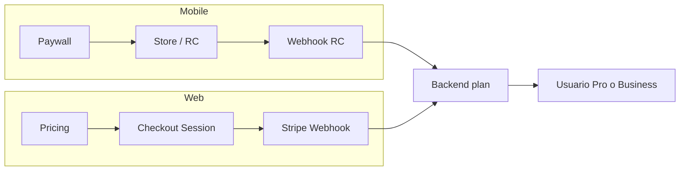

---
tags:
  - prd
  - monetizacion
  - stripe
  - revenuecat
  - solennix
aliases:
  - Monetización
  - Monetization
date: 2026-03-20
updated: 2026-08-05
status: active
---

# Monetización — Solennix

**Version:** 3.0  
**Actualizado:** 2026-08-05  
**Alcance:** Tiers, precios, gating y billing (iOS · Android · Web · Backend)  
**Mercado:** Organizadores de eventos en LATAM

> [!tip] Fuentes hermanas
>
> - [[02_FEATURES]] — catálogo de producto y paridad (v2.0)
> - [[11_CURRENT_STATUS]] — snapshot operativo
> - [[15_MARKETPLACE_V2]] — inbound / directorio (NG1: sin comisión ni pay-per-lead)
> - Código de gates: `backend/internal/handlers/plan_utils.go` (`PlanTiers`, `FeatureAvailable`) + límites en CRUD/staff/request links

---

## 1. Modelo vigente — 3 tiers

| Tier (UI) | Valor API / DB | Precio ancla USD | Público |
| :--- | :--- | :--- | :--- |
| **Gratis** | `basic` (aliases: `free`, `gratis`, `plan_basic`) | $0 | Probador / organizador nuevo |
| **Pro** | `pro` (aliases: `premium`, `plan_pro`) | $15/mes o $144/año (−20%) | 5–30 eventos/mes |
| **Business** | `business` (aliases: `enterprise`, `plan_business`) | $49/mes o $470/año (−20%) | Equipo, marca, visibilidad |

**Normalización canónica:** `models.NormalizePlan` — un solo mapping en backend.  
iOS `Plan` enum: `basic` | `pro` | `business` | `premium` (legacy → tratar como paid).

### 1.1 Precios referenciales LATAM (PPP)

| Tier | MXN/mes | ARS/mes | COP/mes | CLP/mes |
| :--- | ---: | ---: | ---: | ---: |
| Pro | $299 | $15.000 | $60.000 | $14.000 |
| Business | $899 | $49.000 | $199.000 | $45.000 |

Precios reales en store/Stripe pueden diferir; alinear dashboards externos con esta ancla.

### 1.2 Filosofía de gating

> [!important] Gratis con *taste*, no muros opacos
> Gratis opera el negocio real (eventos, clientes, catálogo, pagos **manuales**, portal básico, perfil público básico).  
> Pro+ desbloquea **calidad cara-al-cliente** (branding, submissions, perfil full, reviews públicas, packages) y escala.  
> Business suma **equipo login** + **destacado en directorio**.  
> Upgrade driver principal: **calidad de marca + inbound**, no solo cantidad.

**NG1 (inmutable):** Solennix **no** intermedia pagos organizador↔cliente ni cobra comisión por lead. Stripe/App Store/Play = solo suscripción del organizador a Solennix.

### 1.3 Free trial

- **Pro y Business:** 14 días (Stripe trial shipped). Mobile: configurar intro offer en stores / RevenueCat.
- Cancelación durante trial: 1 click, sin fricción.

### 1.4 Plan gifted (admin)

```
PUT /api/admin/users/{id}/upgrade
Body: { "plan": "pro" | "business", "expires_at": "YYYY-MM-DD" }  // expires_at opcional
```

Solo rol `admin`. No degradar suscripción de pago activa sin cancelar primero.

---

## 2. Matriz de gating (fuente de verdad de producto)

**Convención de estado en celdas**

| Símbolo | Significado |
| --- | --- |
| ✓ | Incluido |
| — | No incluido |
| 🔄 | Ship parcial / UI residual |
| 📋 | En matriz comercial / `PlanTiers` pero **no enforced** o no shipped end-to-end |
| ∞ | Sin techo de escala |

### 2.1 Límites de escala (enforced en backend)

Valores = runtime actual. Si cambian, actualizar **código + esta tabla + [[02_FEATURES]] §2**.

| Feature | Gratis (`basic`) | Pro | Business | Enforcement |
| :--- | :---: | :---: | :---: | :--- |
| Eventos / mes calendario | **4** | ∞ | ∞ | `crud` create event |
| Clientes | **20** | ∞ | ∞ | `crud` create client |
| Productos | **15** | ∞ | ∞ | `crud` create product |
| Inventario | **30** | ∞ | ∞ | `crud` create inventory |
| Catálogo compuesto (productos + inventario) | **20** | ∞ | ∞ | advisory lock `catalog` |
| Staff seats (`staff` rows) | **1** | **2** | ∞ | `staff` create |
| Links de solicitud activos | **3** | ∞ | ∞ | `public_request_links` |

> [!note] Staff Pro = 2
> Código: `staff_handler` `case "pro": seatLimit = 2`. No documentar 3.

### 2.2 Core ops (todos los planes, con límites de escala)

| Feature | Gratis | Pro | Business | Notas |
| :--- | :---: | :---: | :---: | :--- |
| Eventos / clientes / productos / inventario / calendario | ✓ | ✓ | ✓ | |
| Pagos **manuales** (registro del organizador) | ✓ | ✓ | ✓ | NG1 |
| Dashboard KPIs básicos | ✓ | ✓ | ✓ | |
| Chart ingresos (serie server) | 🔄 | ✓ | ✓ | UI puede ocultar en free; no es el driver principal |
| PDF presupuesto/contrato/listas (server) | ✓ básico | ✓ | ✓ | |
| Branding PDF (logo/color/plantilla editable) | limitado | ✓ (`custom_branding`) | ✓ | Contract template custom = paid (`auth` handler) |
| Widgets / Live Activity | ✓¹ | ✓ | ✓ | ¹ sin gate fuerte en código hoy |
| Búsqueda, quick quote, multi-moneda, i18n ES/EN | ✓ | ✓ | ✓ | |

### 2.3 Cara-al-cliente y comunicación

| Feature | Gratis | Pro | Business | Código / estado |
| :--- | :---: | :---: | :---: | :--- |
| Portal cliente post-venta (link por evento) | ✓ básico (footer Solennix) | ✓ full + branding | ✓ | shape por plan |
| Payment submissions (cliente reporta transferencia + inbox org) | — | ✓ | ✓ | `payment_submissions` en `PlanTiers` |
| Bulk approve / auto-match CSV | — | 📋 | 📋 | roadmap, no core shipped |
| Notificaciones cliente (email/SMS/WhatsApp API) | — | 📋 | 📋 WhatsApp Biz | |
| Thread / decisiones / firma digital / RSVP | — | 📋 | 📋 | en `PlanTiers` pro+; producto incompleto |
| Reseñas post-evento (flujo email + privacidad) | 🔄 | ✓ | ✓ | `reviews` feature flag Pro+ para públicas |
| Responder reviews + portfolio público | — | ✓ | ✓ | |

### 2.4 Personal / colaboradores

| Feature | Gratis | Pro | Business | Enforcement |
| :--- | :---: | :---: | :---: | :--- |
| Catálogo staff + asignar + turnos/RSVP + teams | ✓ (1 seat) | ✓ (2 seats) | ✓ ∞ | seats |
| Email al colaborador al asignar | — | ✓ | ✓ | Pro+ |
| Login colaborador + portal team member | — | — | ✓ | rol `team_member`; invite Business |

### 2.5 Discovery & inbound (v2) — extensión SaaS

> [!important] No es marketplace
> Sin pay-per-lead, sin comisión. Cliente = audiencia del **proveedor**. Ver [[15_MARKETPLACE_V2]].

| Feature | Gratis | Pro | Business | Notas |
| :--- | :---: | :---: | :---: | :--- |
| Perfil público `/u/:slug` (opt-in) | ✓ **básico** | ✓ **full** | ✓ full | `public_profile_basic` / `public_profile_full` |
| ≤3 servicios en perfil | ✓ | ∞ (honra flags) | ∞ | Free cap en código |
| Portfolio (máx 6) / packages / FAQ / socials | — | ✓ | ✓ | Pro+ handlers |
| Reviews en perfil público | — | ✓ | ✓ | requiere `reviews` + toggles |
| Solicitudes (inbox + links + forms públicos) | ✓ (3 links) | ✓ ∞ links | ✓ | unifica ex-formularios |
| Form público en perfil + package quote | ✓ | ✓ | ✓ | anti-spam: rate-limit + honeypot; Turnstile 🔄 |
| Directorio `/providers` listado | ✓ | ✓ | ✓ | solo perfiles publicables |
| **Listing destacado** (ranking featured) | — | — | ✓ | beneficio del tier, no cargo extra |
| Inbound analytics (views + requests) | — | ✓ | ✓ | `FeatureAvailable(..., public_profile_full)` |
| SEO / sitemap perfiles | ✓ | ✓ | ✓ | `sitemap-profiles.xml` |
| Moderación de listing (admin) | admin | admin | admin | cola approve/reject |

**Ranking default directorio** (`sort=relevance`): Featured (Business+) → rating/reviews → actividad → distancia (si geo).

**Modelos descartados (v3+ si se levanta NG1):** pay-per-lead, comisión por transacción.

### 2.6 Integraciones y soporte (comercial)

| Feature | Gratis | Pro | Business | Estado |
| :--- | :---: | :---: | :---: | :--- |
| WhatsApp Business API | — | — | 📋 | no shipped |
| Webhooks / API pública partner | — | 📋 | 📋 | `api_access` true en pro+ en `PlanTiers`; producto partner incompleto |
| Soporte | docs + email | WhatsApp (objetivo 24h) | WhatsApp (objetivo 4h) + onboarding | proceso, no código |

---

## 3. Mapa `PlanTiers` (backend)

Definido en `backend/internal/handlers/plan_utils.go`. Resumen:

| Feature key | basic | pro | business |
| :--- | :---: | :---: | :---: |
| `public_event_portal` / `public_event_form` | ✓ | ✓ | ✓ |
| `payment_tracking` (manual) | ✓ | ✓ | ✓ |
| `payment_submissions` | — | ✓ | ✓ |
| `public_profile_basic` | ✓ | ✓ | ✓ |
| `public_profile_full` | — | ✓ | ✓ |
| `reviews` | — | ✓ | ✓ |
| `custom_branding` | — | ✓ | ✓ |
| `unlimited_staff_seats` | — | — | ✓ |
| `milestones` / `chat` / `decisions` / `contracts` / `rsvp` | — | ✓* | ✓* |
| `api_access` | — | ✓* | ✓* |

\* Flag en mapa; **no implica UI completa shipped**. Producto real → [[02_FEATURES]].

**Error de límite:**

```json
{
  "error": "plan_limit_exceeded",
  "message": "Has alcanzado el límite de tu plan.",
  "limit": { "type": "events", "current": 4, "max": 4 }
}
```

`writePlanLimitError` en `helpers.go`. Límites de escala usan `withPlanLimit` (advisory lock).

---

## 4. Enforcement por capa

| Capa | Qué hace | Estado 2026-08 |
| :--- | :--- | :--- |
| **Backend** | Límites create + `FeatureAvailable` en submissions, portfolio, packages, reviews, inbound analytics, contract template | ✅ **Fuente de verdad** |
| **iOS** | `PlanLimitsManager` (4/20/15/30) + paywall branding/contratos | ✅ alineado a límites de escala |
| **Android** | Paywall RC + gates UI | 🔄 completar paridad de counters |
| **Web** | UpgradeBanner + redirect 403 plan_limit | 🔄; backend ya bloquea |

**Comportamiento al tocar límite:** no se borran datos; solo se bloquea **creación** nueva + CTA upgrade.

---

## 5. Billing por plataforma

### 5.1 Web — Stripe

| Aspecto | Detalle |
| :--- | :--- |
| Checkout | `POST /api/subscriptions/checkout-session` (`plan`, trial) |
| Portal | `POST /api/subscriptions/portal-session` |
| Webhook | `POST /api/subscriptions/webhook/stripe` |
| Prices | `STRIPE_PRO_PRICE_ID`, `STRIPE_BUSINESS_PRICE_ID` |
| Success / cancel | `/dashboard?session_id=` · `/pricing` |

### 5.2 iOS — RevenueCat + StoreKit 2

| Aspecto | Detalle |
| :--- | :--- |
| RC SDK | offerings / entitlement `pro_access` |
| Fallback | StoreKit 2 purchase/restore si RC offline |
| Productos (histórico) | `com.solennix.premium.monthly` / `.yearly` (nombre legacy) |
| Webhook | vía RevenueCat → backend |

### 5.3 Android — RevenueCat + Play Billing

| Aspecto | Detalle |
| :--- | :--- |
| Pantallas | `PricingScreen`, `SubscriptionScreen` |
| Verificación | webhooks RC → `POST /api/subscriptions/webhook/revenuecat` |

### 5.4 Backend — estado de suscripción

| Método | Ruta | Auth |
| :--- | :--- | :--- |
| GET | `/api/subscriptions/status` | usuario |
| POST | `/api/subscriptions/checkout-session` | usuario |
| POST | `/api/subscriptions/portal-session` | usuario |
| POST | `/api/subscriptions/webhook/stripe` | firma Stripe |
| POST | `/api/subscriptions/webhook/revenuecat` | secret RC |
| POST | debug upgrade/downgrade | admin + dev |

`Subscription.provider`: `stripe` | `apple` | `google`.  
`Plan` en user/subscription: normalizado a `basic` | `pro` | `business`.

Webhooks (resumen): purchase/renew → upgrade paid; expiration/delete → `basic`; past_due se marca sin wipe inmediato de datos.

---

## 6. Flujos de compra (resumen)



**Restaurar:** iOS/Android restore nativo o RC; Web = `GET /subscriptions/status` (sin restore manual).  
**Cancelar:** según `provider` (App Store / Play / Stripe Portal). Badge de origen en UI = gap conocido (§8).

---

## 7. Métricas

| Métrica | Target 30d | Target 90d |
| :--- | ---: | ---: |
| Conversion Gratis → paid | ≥ 5% | ≥ 8% |
| Trial → paid | — | ≥ 35% |
| Churn mensual paid | — | < 10% |

Trackear: conversion por tier, revenue por plataforma, paywall view→purchase, límite más golpeado, LTV, **inbound** (views perfil → solicitudes → accept) para validar v2.

---

## 8. Gaps abiertos (honestos)

| # | Gap | Severidad | Notas |
| ---: | :--- | :--- | :--- |
| 1 | Provider de suscripción no visible en UI | Alta UX | Backend ya devuelve `provider`; propuesta en `_archive/proposals/12_SUBSCRIPTION_PLATFORM_ORIGIN.md` |
| 2 | Keys/prices live en dashboards externos | Alta ops | Checklist §9 |
| 3 | Android UI counters de límites | Media | Backend ya enforce |
| 4 | Web UX de límite (además del 403) | Media | |
| 5 | Flags `PlanTiers` (milestones, chat, api_access…) sin producto full | Baja doc | No vender como shipped |
| 6 | Turnstile real en leads públicos | Media inbound | honeypot + rate-limit hoy |
| 7 | Dualidad naming premium vs Pro en stores | Baja | IDs legacy `premium.*` |
| 8 | Inbound analytics / featured polish | Media | gates Pro+/Business definidos |

**Obsoleto (no reabrir como bug):** “backend no enforcea límites” — **falso desde enforcement server-side actual**. “iOS Plan sin `pro`” — **resuelto** (`basic|pro|business|premium`).

---

## 9. Keys y secrets — no confundir

> [!warning] Causa #1 de bugs de billing
> Varias keys por integración. Confundirlas → cobró y no upgrade, o ofertas de test en prod.

### 9.1 Stripe

| Key | Env | Prefix | Uso |
| :--- | :--- | :--- | :--- |
| Secret API | `STRIPE_SECRET_KEY` | `sk_live_` / `sk_test_` | Solo backend |
| Webhook secret | `STRIPE_WEBHOOK_SECRET` | `whsec_` | Validar eventos |
| Price Pro / Business | `STRIPE_PRO_PRICE_ID`, `STRIPE_BUSINESS_PRICE_ID` | `price_` | Checkout |
| Portal config | `STRIPE_PORTAL_CONFIG_ID` (opt) | `bpc_` | Customer Portal |

El web **no** lleva keys de Stripe (redirect vía backend).

### 9.2 RevenueCat (3 keys distintas)

| Key | Dónde | Prefix | Uso |
| :--- | :--- | :--- | :--- |
| Secret server | Backend `REVENUECAT_API_KEY` | `sk_` | REST server |
| Public iOS | `ios/Config/Secrets.xcconfig` | `appl_` | SDK iOS |
| Public Android | gradle / env | `goog_` | SDK Android |

`appl_` **no** significa test vs live — hay apps Test Store y App Store con el mismo prefix. Verificar en dashboard.

### 9.3 Checklist prod

- [ ] `STRIPE_SECRET_KEY` live en VPS
- [ ] Webhook secret live matchea endpoint
- [ ] Price IDs Pro **y** Business live
- [ ] RC secret backend ≠ public mobile
- [ ] RC public iOS/Android = apps **store** live, no Test Store
- [ ] Entitlement `pro_access` + offering default + productos store conectados
- [ ] Productos App Store / Play aprobados o al menos en testing track
- [ ] Webhook RC Authorization header configurado

---

## 10. Bloqueantes externos (humano)

1. Stripe Dashboard — products Pro/Business mensual+anual, webhook, portal  
2. App Store Connect — subscription group + intro 14d  
3. Google Play Console — base plans + trial  
4. RevenueCat — entitlement, offerings, webhook  
5. Resend — dominio + DKIM (emails de staff / producto)

Detalle de producto no-billing → [[09_ROADMAP]] / [[11_CURRENT_STATUS]].

---

## 11. Changelog documental

| Antes (v2.x) | Ahora (v3.0) |
| :--- | :--- |
| Staff Pro = 3 | **2** (código) |
| Sin techo catálogo compuesto | **20** productos+inventario |
| Sin matriz inbound | §2.5 directorio / perfil / solicitudes |
| §§2–4 BASIC/PREMIUM históricos en cuerpo | **Eliminados** del activo (confunden) |
| “Backend no enforcea” | Corregido — **sí enforcea** |
| Mezcla Premium en UI | **Pro / Business** como nombres de producto |

Histórico pre–3-tier y drafts largos: no se reintroducen en este archivo. Si hace falta arqueología, git history de este path.

---

#prd #monetizacion #stripe #revenuecat #solennix
