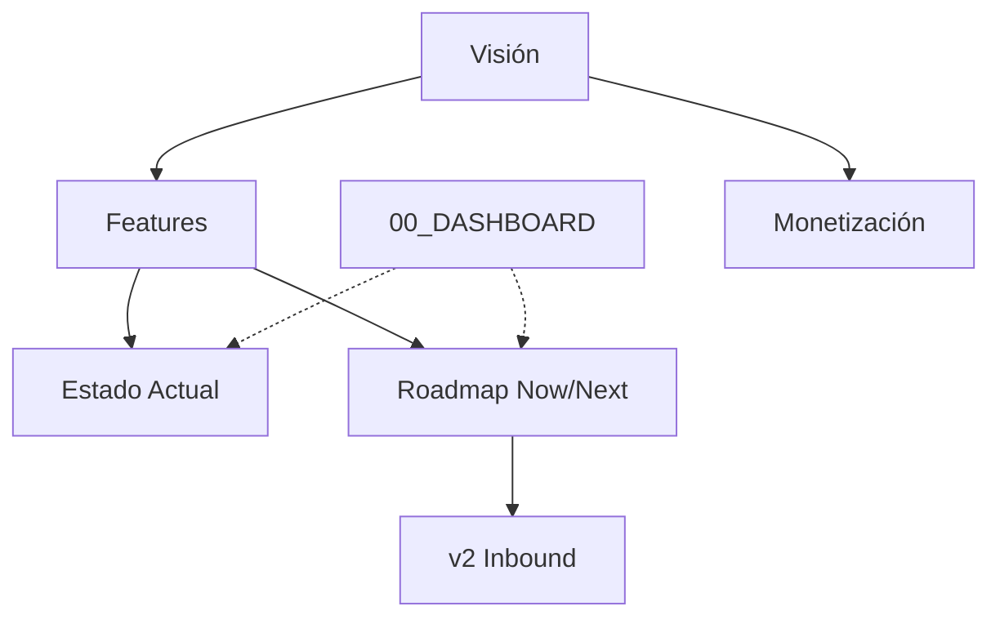

# PRD — Map of Content

> [!info] Solennix
> **Producto**: Plataforma de gestión de eventos para organizadores LATAM
> **Plataformas**: iOS · Android · Web · Backend (Go)
> **Estado**: En producción (4 plataformas live) — ver [[11_CURRENT_STATUS|Estado Actual]]

> [!success] Dashboard Ejecutivo
> Abrí [[../00_DASHBOARD|Dashboard Ejecutivo]] para la vista de 30 segundos.

---

## Visión y estrategia

- [[01_PRODUCT_VISION|Visión del Producto]] — Problema, visión, objetivos, usuarios
- [[03_COMPETITIVE_ANALYSIS|Análisis Competitivo]] — Posicionamiento vs HoneyBook, Excel, WhatsApp y LATAM
- [[04_MONETIZATION|Monetización]] — Tiers Gratis/Pro/Business v3.0, matriz de gating, Stripe/RC, keys

## Features y estado

- [[02_FEATURES|Catálogo de Features]] — Paridad + gates (v2.0, 2026-08); tiers Gratis/Pro/Business
- [[11_CURRENT_STATUS|Estado Actual]] — **Snapshot vivo** (no changelog)
- [[12_CLIENT_TRANSPARENCY_AND_DELIGHT|Transparencia & Delight]] — Features A–L experiencia cliente
- [[14_CLIENT_EXPERIENCE_IDEAS|Ideas experiencia cliente]] — Exploración clusters A–G
- [[15_MARKETPLACE_V2|v2.0 Discovery & Inbound]] — Directorio e inbound (**no marketplace**)

## Arquitectura (índices → docs de plataforma)

Los PRD 05–08 son **punteros**. Detalle canónico en cada MOC de plataforma.

- [[05_TECHNICAL_ARCHITECTURE_IOS|→ iOS]] · [[06_TECHNICAL_ARCHITECTURE_ANDROID|→ Android]] · [[07_TECHNICAL_ARCHITECTURE_BACKEND|→ Backend]] · [[08_TECHNICAL_ARCHITECTURE_WEB|→ Web]]
- [[19_I18N_STRATEGY|i18n Strategy]] — Infra + copy matrix (epic #202 cerrada; doc de governance)
- [[20_SERVER_SIDE_PDF_GENERATION|PDF server-side]] — Backend implementado; paridad residual en clientes

## Planificación

- [[09_ROADMAP|Roadmap]] — **Solo forward** (Now / Next / Later)
- Estándares agentes: [`AGENTS.md`](../../AGENTS.md) + `docs/agents/`

---

## Principios clave

> [!abstract] Paridad Cross-Platform
> Cada feature core y cada bug fix DEBE existir en todas las plataformas. Ver [[01_PRODUCT_VISION]] y [[02_FEATURES]].

> [!abstract] Flujo de Eventos
> **Cotizar → Confirmar → Cobrar anticipo → Ejecutar → Cobrar saldo → Cerrar**.

> [!abstract] LATAM First
> Español nativo, precios en MXN por default, IVA configurable.

> [!abstract] No intermediación de pagos
> Solennix no mueve dinero organizador↔cliente. Ver [[11_CURRENT_STATUS]].

---

## Histórico (no activo)

| Artefacto | Ubicación |
| :--- | :--- |
| Status completo pre-limpieza (ago 2026) | `docs/_archive/prd-history/11_CURRENT_STATUS_full_2026-08.md` |
| Roadmap con sprint diary | `docs/_archive/prd-history/09_ROADMAP_full_2026-07.md` |
| Arquitectura PRD larga (changelog) | `docs/_archive/prd-history/05–08_*` |
| Post-MVP roadmap abr-2026 | `docs/_archive/prd-history/13_POST_MVP_ROADMAP.md` |
| Guía colaboración (superseded por AGENTS) | `docs/_archive/prd-history/10_COLLABORATION_GUIDE.md` |
| Propuesta subscription origin UI | `docs/_archive/proposals/12_SUBSCRIPTION_PLATFORM_ORIGIN.md` |
| SUPER_PLAN 12 semanas | `docs/_archive/SUPER_PLAN/` |
| Trackers / audits | `docs/_archive/` |

---

## Navegación

#prd #moc #solennix
