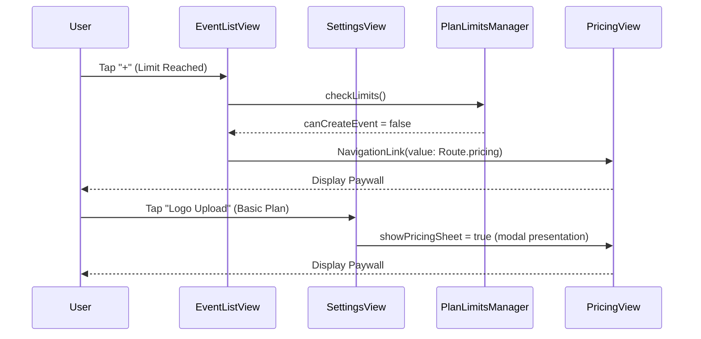

# Design: iOS Feature Gating Enforcement

## Technical Approach
Implement client-side gating in iOS SwiftUI views using conditional layout branching. When a user is on the Basic plan and exceeds limits or accesses custom branding, swap standard interactive views for buttons that trigger a pricing modal sheet or redirect to Route.pricing.

## Architecture Decisions
| Decision | Options Considered | Tradeoffs | Selected Choice & Rationale |
|---|---|---|---|
| Gating logo & color pickers | Disable controls vs Swap with upgrade buttons | Disabling controls gives poor feedback; swapping with upgrade buttons allows direct trigger of paywall modal on tap. | Swapping with upgrade buttons to present a sheet of `PricingView` immediately on click. |
| Navigation redirect | Global router interceptor vs Local view checks | Global router interceptor is complex and requires centralized route filtering; local view check is lightweight and utilizes standard NavigationLink conditional destinations. | Local view checks inside EventListView redirecting NavigationLinks to Route.pricing. |

## Data Flow


## File Changes
| File | Action | Description |
|------|--------|-------------|
| `ios/Packages/SolennixFeatures/Sources/SolennixFeatures/Events/Views/EventListView.swift` | Modify | Inject `PlanLimitsManager`. Call `checkLimits()` on load. Conditionally redirect creation links to `.pricing` when `!canCreateEvent`. Display `UpgradeBannerView`. |
| `ios/Packages/SolennixFeatures/Sources/SolennixFeatures/Settings/ViewModels/BusinessSettingsViewModel.swift` | Modify | Add `canCustomizeBranding` computed property checking paid status. |
| `ios/Packages/SolennixFeatures/Sources/SolennixFeatures/Settings/Views/BusinessSettingsView.swift` | Modify | Add `showPricingSheet` state, `authManager` environment. Replace logo picker and ColorPicker with upgrade sheet triggers. |
| `ios/Packages/SolennixFeatures/Sources/SolennixFeatures/Settings/Views/ContractDefaultsView.swift` | Modify | Add `showPricingSheet` state, `authManager` environment. Wrap lock banner in a button that triggers the sheet. |

## Interfaces / Contracts
```swift
// Added to BusinessSettingsViewModel
public var canCustomizeBranding: Bool {
    user?.plan.isPaid ?? false
}
```

## Testing Strategy
| Layer | What to Test | Approach |
|-------|-------------|----------|
| Unit | `canCustomizeBranding` and `canCustomizeContractTemplate` plan evaluations | Verify paid/free status returns expected Boolean flags on `BusinessSettingsViewModel` mock. |
| Manual | Gated event creation and branding locks | Run iOS Simulator, verify Basic user cannot navigate to event form (redirects to Pricing) and custom settings display locks that trigger Paywall sheet modal. |
