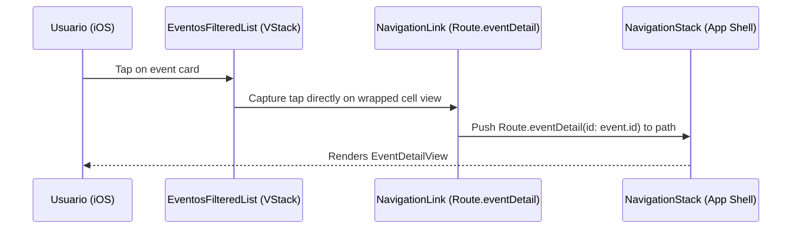

# Design: iOS Calendar Event Tap Redirection

## Technical Approach
Refactorizar `EventosFilteredList` en `EventosLayoutFactory.swift` para que cada celda de evento sea envuelta directamente en un `NavigationLink` en lugar de usar un `ZStack` con un `NavigationLink` invisible envolviendo `EmptyView()`. 

Esta modificación es necesaria porque `EventosFilteredList` utiliza un contenedor `VStack` plano en lugar de un `List` nativo de iOS. En SwiftUI, los `NavigationLink` invisibles con `EmptyView` dentro de un `ZStack` no reciben eventos de hit-test fuera de un `List`, lo que rompe la interactividad. Al envolver directamente la celda (`cell(event)`) en el `NavigationLink`, SwiftUI detecta y responde al toque de la celda de forma nativa e inmediata.

## Data Flow


## File Changes
| File | Action | Description |
|------|--------|-------------|
| `ios/Packages/SolennixFeatures/Sources/SolennixFeatures/Events/Views/EventosLayoutFactory.swift` | Modify | Reemplazar `ZStack` con `NavigationLink` directo en `EventosFilteredList`. |

## Interfaces / Contracts
El contrato público de `EventosLayoutFactory` y su función `make` permanecen inalterados. La modificación se limita estrictamente a la implementación interna de `EventosFilteredList`.

```swift
// Antes (Líneas 157-163 en EventosLayoutFactory.swift)
ZStack {
    cell(event)
    NavigationLink(value: Route.eventDetail(id: event.id)) {
        EmptyView()
    }
    .opacity(0)
}
.buttonStyle(.plain)

// Después
NavigationLink(value: Route.eventDetail(id: event.id)) {
    cell(event)
}
.buttonStyle(.plain)
```

## Testing Strategy
Validar mediante pruebas de UI en iOS (`SolennixUITests`) que al encontrarse en la vista de calendario, se pueda interactuar y seleccionar una tarjeta de evento.
