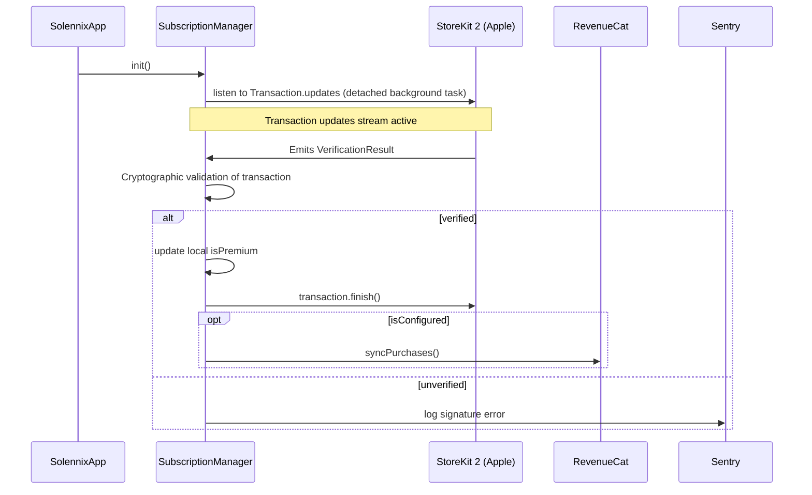

# Design: StoreKit 2 Purchase Flow

## Technical Approach
Implement a background transaction updates listener using StoreKit 2 `Transaction.updates` inside `SubscriptionManager`'s initializer. This ensures any out-of-app purchase/renewal is verified and completed. When RevenueCat is unconfigured, bypass RC APIs and check entitlements/perform purchases/restores directly using native StoreKit 2 APIs.

## Architecture Decisions
| Decision | Options Considered | Tradeoffs | Selected Choice & Rationale |
|---|---|---|---|
| Background listener lifetime | detatched Task vs class-bound Task | Detached Task escapes the object lifetime; class-bound Task can be cancelled on deinit. | Class-bound Task inside SubscriptionManager init with weak self capture. Cancels on deinit to prevent leaks. |
| Entitlement verification | Client-side cryptographic verification vs trust client receipts | Cryptographic verification ensures signature integrity; raw trust is insecure. | Local cryptographic signature validation using VerificationResult pattern matching. Unverified items are ignored & logged. |

## Data Flow


## File Changes
| File | Action | Description |
|------|--------|-------------|
| `ios/Packages/SolennixNetwork/Sources/SolennixNetwork/SubscriptionManager.swift` | Modify | Implement updates listener Task, cryptographic verification, local entitlement check, and StoreKit direct restore/purchase fallback logic. |
| `ios/Packages/SolennixFeatures/Sources/SolennixFeatures/Settings/Views/PricingView.swift` | Modify | Bind fallback product interactions correctly to direct StoreKit purchase/restore flows. |

## Interfaces / Contracts
```swift
// Added properties/methods to SubscriptionManager
private var updatesTask: Task<Void, Never>?

@MainActor
private func handleTransactionUpdate(_ verificationResult: VerificationResult<Transaction>) async

@MainActor
private func refreshLocalStoreKitEntitlements() async
```

## Testing Strategy
| Layer | What to Test | Approach |
|-------|-------------|----------|
| Unit | SubscriptionManager local entitlement check | Verify direct StoreKit 2 currentEntitlements fallback when isConfigured is false in mock environment. |

## Migration / Rollout
No migration required. Directly backward-compatible fallback logic.
