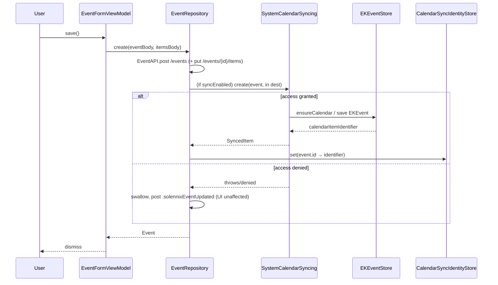
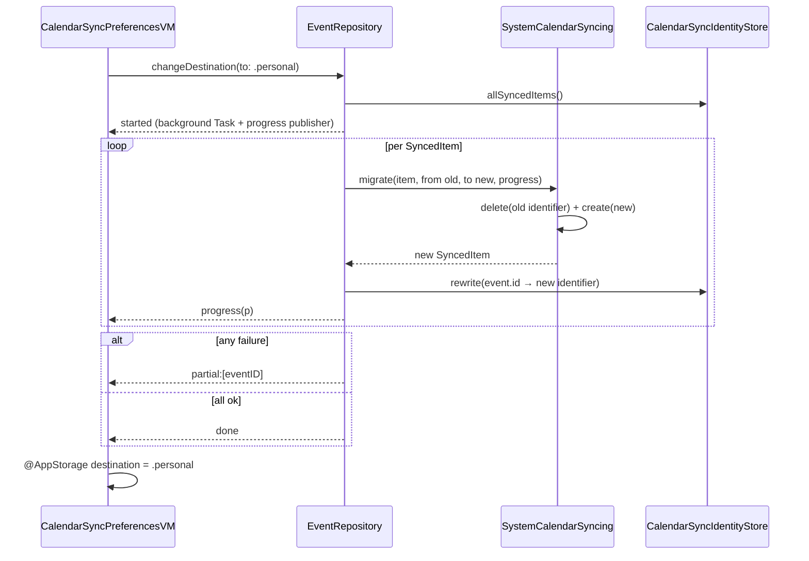
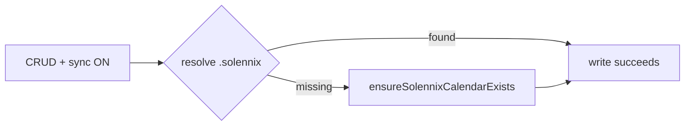
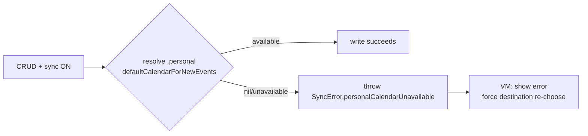

# Design: Unify Events + Calendar on iOS

> iOS-only change. No Web/Android code touched. **Strict TDD ACTIVE** — every
> spec scenario maps to an XCTest. Implements the locked decisions in
> `proposal.md` and satisfies all **25** scenarios across the 3 deltas in
> `specs/{events-calendar,calendar-sync,navigation}` (events-calendar=11,
> calendar-sync=11, navigation=3).

## Technical Approach

Fold the dedicated **Calendar** screen into **Eventos** as a `.calendario` view
mode of the existing `EventListView`, driven by one `@Observable
EventListViewModel` (both modes read the same `events` array — no reload on
toggle). Introduce a new write-only **EventKit sync** path behind a testable
protocol seam, with sync hooks attached at a new **repository boundary** so
every create/edit/delete (form, list status-change, list delete) mirrors to the
system calendar consistently regardless of UI path. Replace the stale iCal
snapshot export with that live sync. Add a Settings screen
(`CalendarSyncPreferencesView`) replicating the `NotificationPreferencesView`
pattern. Drop the Calendar tab (5 → 4).

## Architecture Overview — Component Map

| Component | Status | Location (under `ios/Packages/...`) | Notes |
|-----------|--------|--------------------------------------|-------|
| `SystemCalendarSyncing` (protocol) | **NEW** | `SolennixFeatures/.../CalendarSync/SystemCalendarSyncing.swift` | EventKit abstraction seam |
| `EventKitSyncService` (prod impl) | **NEW** | `SolennixFeatures/.../CalendarSync/EventKitSyncService.swift` | `EKEventStore`-backed, write-only |
| `EventRepository` | **NEW** | `SolennixFeatures/.../Events/Repositories/EventRepository.swift` | Holds a narrow `EventAPI` protocol (ADR-9) over concrete `APIClient`; CRUD + delegates to sync |
| `EventAPI` (protocol) | **NEW** | `SolennixNetwork/Sources/SolennixNetwork/EventAPI.swift` | Event get/post/put/delete seam; `extension APIClient: EventAPI {}` (zero behavior change) |
| `CalendarSyncIdentityStore` (protocol + impl) | **NEW** | `SolennixFeatures/.../CalendarSync/CalendarSyncIdentityStore.swift` | `event.id → calendarItemIdentifier` side-store |
| `CalendarSyncPreferencesView` + VM | **NEW** | `SolennixFeatures/.../Settings/Views/` + `ViewModels/` | Replicates `NotificationPreferencesView` |
| Onboarding tip view | **NEW** | `SolennixFeatures/.../Events/Views/EventosOnboardingTip.swift` | TipKit, single `@AppStorage` flag |
| `EventListView` | **MODIFY** | `.../Events/Views/EventListView.swift` | +view toggle, period chips, `.calendario` body, day-tap/long-press |
| `EventListViewModel` | **MODIFY** | `.../Events/ViewModels/EventListViewModel.swift` | Absorb month nav, block dates, day/period filters |
| `Route.calendarSyncPreferences` | **ADD** | `SolennixCore/Sources/SolennixCore/Route.swift` | New nav case |
| `Route.swift` (app) `Tab`/`SidebarSection` | **MODIFY** | `ios/Solennix/Navigation/Route.swift` | Remove `.calendar` from both enums + `mainSections` |
| `SettingsView` | **MODIFY** | `.../Settings/Views/SettingsView.swift` | New section/link → sync prefs (both width layouts) |
| `SettingsStrings` | **MODIFY** | `.../Settings/SettingsStrings.swift` | Sync toggle/destinations/warning/error keys |
| `CalendarGridView` | **MOVE** | `.../Calendar/Views/` → `.../Events/Views/` | Closure-based, already decoupled |
| `BlockDateSheet`, `BlockedDatesSheet` (+`AddBlockSheet`) | **MODIFY+MOVE** | `.../Calendar/Views/` → `.../Events/Views/` | Retype `@Bindable viewModel` → `EventListViewModel` |
| `DateDay`, `CalendarError` (block subset) | **MOVE** | `.../Calendar/ViewModels/CalendarViewModel.swift` → `.../Events/Models/DateDay.swift` | Keep `CalendarGridView` compiling |
| `CalendarView` | **REMOVE** | `.../Calendar/Views/CalendarView.swift` | + `ActivityView`, `eventRowContent`, iCal button |
| `CalendarViewModel` | **REMOVE** | `.../Calendar/ViewModels/CalendarViewModel.swift` | Logic migrated to `EventListViewModel` |
| `exportCalendarToFile()` | **REMOVE** | (was on `CalendarViewModel`) | Replaced by EventKit |

> All new code lives inside the `SolennixFeatures` Swift Package. `Route` cases
> live in `SolennixCore` (shared). `Tab`/`SidebarSection` live in the app target.

## Architecture Decisions (ADR-style)

### ADR-1 — EventKit protocol seam (`SystemCalendarSyncing`)
**Context**: `EKEventStore` is a concrete final class — not mockable in XCTest, blocking Strict TDD.
**Options**: (a) wrap `EKEventStore` in a `protocol SystemCalendarSyncing` with a domain enum for authorization; (b) test against the real store (flaky, permission prompts).
**Decision**: (a). Define `SystemCalendarSyncing` with **domain types only** (no `EK*` leak) so test doubles are trivial.
**Consequences**: prod impl `EventKitSyncService` maps domain↔`EKEvent`; tests use a recording `MockSystemCalendarSyncing`.

```swift
public enum SyncAuthorization: Sendable, Equatable { case notDetermined, denied, restricted, fullAccess }
public enum SyncDestination: String, Sendable { case solennix, personal }   // binary, solennix default

public struct SyncedItem: Sendable, Equatable { public let eventID: String; public let calendarItemIdentifier: String }

// Identifier-based, NOT an EKCalendar wrapper. EKCalendar is a non-Sendable
// NSObject, so it cannot cross the protocol boundary. The actor EventKitSyncService
// resolves these identifiers back to EKCalendar internally via EKEventStore.
public struct SyncedDestination: Sendable, Equatable {
    public let calendarIdentifier: String   // EKCalendar.calendarIdentifier
    public let sourceIdentifier: String     // EKSource.sourceIdentifier
}

public protocol SystemCalendarSyncing: AnyObject, Sendable {
    func authorizationStatus() -> SyncAuthorization
    func requestAccess() async -> SyncAuthorization
    func resolveDestination(_ kind: SyncDestination) async throws -> SyncedDestination
    func create(_ event: Event, in dest: SyncedDestination) async throws -> SyncedItem
    func update(_ event: Event, identifier: String, in dest: SyncedDestination) async throws
    func delete(identifier: String, in dest: SyncedDestination) async throws
    func migrate(_ items: [SyncedItem], from: SyncedDestination, to: SyncedDestination,
                 progress: @Sendable (Double) -> Void) async throws -> [SyncedItem]
    func ensureSolennixCalendarExists() async throws -> SyncedDestination
}
```
`SyncedDestination` carries only `String` identifiers so it is `Sendable` + `Equatable`
and no `EK*` type escapes the protocol. The `actor EventKitSyncService` owns the only
`EKEventStore` reference and resolves `calendarIdentifier`/`sourceIdentifier` to the live
`EKCalendar`/`EKSource` on each call (they are stable across launches).

### ADR-2 — Sync hooks attach at a new `EventRepository` boundary (not the ViewModels)
**Context**: today there are **3 event-mutation call-sites across 2 VM classes** — `EventFormViewModel.save`, `EventListViewModel.confirmDeleteEvent`, and `EventListViewModel.updateEventStatus`. (`CalendarViewModel` only *reads* events, so it is not a mutation site.) Sync must be consistent for **every** path.
**Options**: (a) call the sync service in each VM (duplicated, drift-prone); (b) introduce `EventRepository` that owns `APIClient` CRUD and fans out to sync.
**Decision**: (b). `EventRepository` is the single mutation surface; VMs hold it instead of (or wrapping) `APIClient`.
**Consequences**: one seam = one test. `create/update/delete` each return the persisted `Event` then `await syncService...` guarded by `syncEnabled`. Existing VM call sites are rewired to the repository. Local state patches stay in the VMs.

### ADR-3 — Destination resolution strategy
**Context**: "Solennix" is an app-managed calendar; "Personal" is the user's default.
**Decision**: `resolveDestination(.solennix)` → find by `title == "Solennix"` in the user's calendars; missing → `ensureSolennixCalendarExists()` (create a new `EKCalendar` on the default `EKSource`, color primary). `resolveDestination(.personal)` → `EKEventStore.defaultCalendarForNewEvents`; **nil/none → throw `SyncError.personalCalendarUnavailable`** (surfaced as error + re-choose per spec).

### ADR-4 — Migration strategy (destination change)
**Context**: switching destination must move all synced events; must not block UI; must report progress.
**Decision**: `EventRepository.changeDestination(to:)` runs on a detached `Task`. It (1) loads all `SyncedItem`s for the old destination from the identity store, (2) `syncService.migrate(...)` deletes each from old + creates in new, (3) rewrites the identity store with the **new** identifiers, (4) publishes `progress` 0…1. **Partial-failure recovery**: per-item try/catch — on failure the event keeps its old identifier and is skipped (logged); the migration reports `partial: [eventID]` instead of throwing wholesale, so a half-done switch is recoverable by re-running.

### ADR-5 — Identity persistence: local side-store keyed by `event.id`
**Context**: `EKEvent.calendarItemIdentifier` must persist so create/update/delete are idempotent and migration can find them.
**Options**: (a) add `calendarItemIdentifier: String?` to the `Event` model → **requires backend schema + 3-platform parity** (out of scope, violates iOS-only); (b) local side-store keyed by `event.id`.
**Decision**: (b). New `CalendarSyncIdentityStore` protocol + `UserDefaultsCalendarSyncIdentityStore` impl, mapping `[Solennix event.id : EKEvent.calendarItemIdentifier]` + the `SyncDestination` each was written to.
**Consequences**: zero backend change; identity is device-local (acceptable — sync is per-device write-only). Test double provided. On sync-OFF the store is retained (enables clean re-enable); full purge available behind a "clear sync data" action if later needed.

### ADR-6 — Toggle / permission flow
**Context**: master toggle is both opt-in and the EventKit permission re-prompt surface.
**Decision**: `@AppStorage("calendarSyncEnabled") var syncEnabled`. Toggling ON → `syncService.requestAccess()` (iOS 17 `requestFullAccessToEvents`). Granted → continue; **denied/restricted** → revert toggle, set `SyncAuthorization.denied`, UI shows "open Settings" deep-link (`UIApplication.openSettingsURLString`) and **skips sync** while `.calendario` stays fully functional (graceful degradation). Destination persisted via `@AppStorage("calendarSyncDestination")` default `.solennix`.

### ADR-7 — View toggle state is ephemeral, default `.lista`
**Context**: spec mandates default Lista, no persistence.
**Decision**: `@State var viewMode: EventosViewMode = .lista` on `EventListView` (NOT `@AppStorage`). `enum EventosViewMode { case lista, calendario }`. Toggling only mutates `viewMode`; it **never** touches `events`/`selectedDay`/filters → satisfies "same events retained, no reload".

### ADR-8 — Snapshot/layout test harness (resolves spec risk #2)
**Context**: need to test iPad-split vs iPhone-stack deterministically. No snapshot lib, no `SolennixFeaturesTests` target today.
**Options**: (a) add `pointfreeco/swift-snapshot-testing` + a new `SolennixFeaturesTests` target with a size-class-driven view factory; (b) `UIView`-introspection assertions only.
**Decision**: (a). Add the dependency to `Package.swift`, add `.testTarget(name: "SolennixFeaturesTests", dependencies: [...])`. A `EventosLayoutFactory.make(vm:viewMode:sizeClass:)` view builder is the unit snapshot asserts against — `regular×regular` (iPad landscape) → split, `compact×regular` (iPhone) → stack. Snapshots render on a fixed simulator config (`xcodebuild` test plan).
**Consequences**: one new dependency; deterministic pixel-diff for the `.calendario` layout.

### ADR-9 — Repository test seam: introduce a NARROW `EventAPI` protocol (not URLProtocol)
**Context** (BLOCKER, gate FAIL): `APIClient` is a concrete `public actor` (`APIClient.swift:29`) with no protocol and cannot be subclassed or mocked. Every VM injects it concretely (`init(apiClient: APIClient)`). The earlier draft proposed an "`MockAPIClient`-style fake" for `EventRepository` tests — **impossible against a concrete actor**. Repository-layer unit tests (the core Strict-TDD surface for create→sync, idempotency, migration, partial-failure) need a real seam.

**Options**:

| Option | Tradeoff | Decision |
|--------|----------|----------|
| (a) **Narrow `protocol EventAPI`** — only the event endpoints the repository calls; concrete `APIClient` conforms (zero behavior change); `MockEventAPI` in test target | + true unit isolation of `EventRepository` sync fan-out (both API + sync seams are simple test doubles); + additive conformance, non-breaking; − one new protocol in the network/features boundary; rewires N `init(apiClient:)` call sites to also receive a repository | **CHOSEN** |
| (b) `URLProtocol`-based stubbing of the real `APIClient` (no protocol) | + no protocol/zero surface change; − integration-flavored (builds JSON fixtures, matches URLs, exercises real decoding/routing); slow/brittle; can't cheaply assert "create → sync → identity-store → return Event" ordering; does not isolate the sync fan-out | rejected |

**Decision**: (a). `EventAPI` exposes ONLY what `EventRepository` needs — `get`/`post`/`put`/`delete` for the event + event-items endpoints — mirroring the `APIClient.post(_:body:)` / `put(_:body:)` / `delete(_:)` signatures already in use. The concrete `APIClient` already implements these, so conformance is a one-line `extension APIClient: EventAPI {}` with **no behavioral change**. `EventRepository` holds an `EventAPI`; `MockEventAPI` (a simple `@Sendable actor` recording calls + returning canned `Event`s) lives in the test target.

```swift
// SolennixNetwork (or SolennixFeatures) — narrow seam over the concrete actor
public protocol EventAPI: AnyObject, Sendable {
    func get<T: Decodable>(_ endpoint: Endpoint, as: T.Type) async throws -> T
    func post<T: Decodable>(_ endpoint: Endpoint, body: AnyCodable, as: T.Type) async throws -> T
    func put<T: Decodable>(_ endpoint: Endpoint, body: AnyCodable, as: T.Type) async throws -> T
    func delete(_ endpoint: Endpoint) async throws
}
extension APIClient: EventAPI {}   // existing methods already satisfy the contract
```

**Concrete consequence / rewiring**: the two mutation-bearing VM classes (`EventFormViewModel`, `EventListViewModel`) currently take `init(apiClient: APIClient)`. Under this change they additionally take `init(..., eventRepository: EventRepository)` and route their 3 mutation call-sites through the repository; non-event `APIClient` usage (clients, etc.) stays on `APIClient`. `EventRepository.init(eventAPI:syncService:identityStore:syncEnabled:)` receives `APIClient` as its `EventAPI`. Test target gains `MockEventAPI` (asserts recorded endpoint/body calls). This is the minimal rewire that keeps every repository-sync scenario a fast, isolated XCTest with NO `URLSession` and NO `EKEventStore`.

## Sequence Diagrams

### 1. Event create → write-only sync (happy + denied)


### 2. Destination change → auto-migration


### 3a. "Solennix" missing → recreate


### 3b. "Personal" missing → error + re-choose


### 4. Day-tap vs long-press gesture resolution
```mermaid
flowchart TD
    G[Gesture on DayCellView] --> T{.onTapGesture}
    G --> L{LongPressGesture ≥0.5s<br/>(simultaneousGesture)}
    T -->|fires| TF[selectDate(day) →<br/>selectedDay + dateRange range=day → filter]
    L -->|fires first| LF[onLongPressDate → open BlockDateSheet<br/>day-tap NOT applied]
```
`CalendarGridView` already wires `onTapGesture` + `simultaneousGesture(LongPressGesture(minimumDuration:0.5))`; the long-press wins once its minimum duration elapses, the tap is suppressed by the gesture system — exactly the spec requirement (gestures MUST NOT trigger each other).

## State Model — Unified `EventListViewModel`

| Property | Type | Persistent? | Source / notes |
|----------|------|-------------|----------------|
| `events` | `[Event]` | ephemeral (cache-backed) | existing — shared by both modes |
| `clients` / `clientMap` | `[Client]` / computed | ephemeral | existing |
| `searchQuery` | `String` | ephemeral | existing |
| `selectedStatus` | `EventStatus?` | ephemeral | existing; replaces `CalendarViewModel.statusFilter` |
| `dateRangeStart` | `Date?` | ephemeral | existing — **written by day-tap AND period chips** |
| `dateRangeEnd` | `Date?` | ephemeral | existing — **written by day-tap AND period chips** |
| `periodFilter` | `EventPeriodFilter?` | ephemeral | **NEW** `.today/.thisWeek/.thisMonth/.custom`; non-nil = a chip is active; `custom` defers to `dateRange*` |
| `selectedDay` | `Date?` | ephemeral | **NEW** — set by day-tap; drives the `.calendario` day list; clearing it shows all |
| `currentMonth` | `Date` | ephemeral | **NEW** (from `CalendarViewModel`) — grid month |
| `unavailableDates` | `[UnavailableDate]` | ephemeral | **NEW** (from `CalendarViewModel`) |
| `sortField` / `sortAscending` | `EventSortField` / `Bool` | ephemeral | existing |
| `isLoading` / `errorMessage` | `Bool` / `String?` | ephemeral | existing |
| `isBlockingDate` | `Bool` | ephemeral | **NEW** (from `CalendarViewModel`) |
| `calendarError` | `CalendarError?` | ephemeral | **NEW** — typed block/load errors |
| `deleteTarget`/`showDeleteConfirm`/`updatingStatusEventId` | various | ephemeral | existing |

**Shared-filter invariant**: day-tap calls `selectDate(day)` which sets `selectedDay = day`, `periodFilter = nil`, and `dateRangeStart = dateRangeEnd = startOfDay(day)`. Period-chip tap sets `periodFilter`, recomputes `dateRangeStart/End` from `Calendar.current` (today / week / month) and clears `selectedDay`. Both write the **same** `dateRange*` pair so `filteredEvents` stays one code path in both Lista and Calendario.

> `viewMode` lives on the **view** (`EventListView`), not the VM — it is presentation only and must never reload data.

## File Changes

| File | Action | Description |
|------|--------|-------------|
| `CalendarSync/SystemCalendarSyncing.swift` | Create | Protocol + `SyncAuthorization`/`SyncDestination`/`SyncedItem`/`SyncedDestination`/`SyncError` |
| `CalendarSync/EventKitSyncService.swift` | Create | `EKEventStore` prod impl |
| `CalendarSync/CalendarSyncIdentityStore.swift` | Create | Protocol + `UserDefaults` impl + mock |
| `CalendarSync/MockSystemCalendarSyncing.swift` | Create | Test double (in test target) |
| `Events/Repositories/EventRepository.swift` | Create | CRUD + sync fan-out (holds `EventAPI` + sync + identity store) |
| `SolennixNetwork/.../EventAPI.swift` | Create | Narrow `protocol EventAPI`; `extension APIClient: EventAPI {}` (ADR-9) |
| `SolennixFeaturesTests/.../MockEventAPI.swift` | Create | `EventAPI` test double — records endpoint/body, returns canned `Event` (ADR-9) |
| `Settings/Views/CalendarSyncPreferencesView.swift` | Create | Toggle + binary destination + warning |
| `Settings/ViewModels/CalendarSyncPreferencesViewModel.swift` | Create | `togglePreference`/`inFlightKeys` parity |
| `Events/Views/EventosOnboardingTip.swift` | Create | TipKit, `@AppStorage("eventosOnboardingShown")` |
| `Events/Views/EventListView.swift` | Modify | Toggle, period chips, `.calendario` body, gestures |
| `Events/ViewModels/EventListViewModel.swift` | Modify | Absorb month/block/day/period; inject `EventRepository` |
| `Events/Views/EventFormViewModel*.swift` (3 files) | Modify | Rewire to `EventRepository` |
| `Events/Models/DateDay.swift` | Create (move) | + `CalendarError` (block subset) |
| `Calendar/Views/{CalendarGridView,BlockDateSheet,BlockedDatesSheet}.swift` | Move | into `Events/Views/`; retype sheets to `EventListViewModel` |
| `Calendar/Views/CalendarView.swift` | Delete | + `ActivityView`, `eventRowContent` |
| `Calendar/ViewModels/CalendarViewModel.swift` | Delete | logic migrated |
| `Calendar/CalendarStrings.swift` | Modify | drop iCal/export keys; keep grid/block keys |
| `SolennixCore/.../Route.swift` | Modify | + `case calendarSyncPreferences` |
| `ios/Solennix/Navigation/Route.swift` | Modify | remove `.calendar` from `Tab`+`SidebarSection`+`mainSections` |
| `Settings/SettingsStrings.swift` | Modify | + sync strings |
| `Settings/Views/SettingsView.swift` | Modify | sync section/link both layouts |
| `SolennixFeatures/Package.swift` | Modify | + `swift-snapshot-testing` dep + `SolennixFeaturesTests` target |

## Interfaces / Contracts

`EventRepository` (new, the mutation boundary). `create` reuses the **existing**
`EventFormViewModel+Save` body-building shape verbatim — a `var body: [String: Any]`
wrapped in `AnyCodable`, plus a second `AnyCodable` items body (products/extras/
equipment/supplies/staff). No new `EventDraft` type is introduced (the form VM
already owns field-rounding/clamping; duplicating it into a struct would be scope
creep and drift). `create` mirrors the existing two-call sequence (`POST /events`
then `PUT /events/{id}/items`):

```swift
public protocol EventRepository: AnyObject, Sendable {
    func list() async throws -> [Event]
    func create(eventBody: AnyCodable, itemsBody: AnyCodable) async throws -> Event   // syncs; matches EventFormViewModel+Save
    func update(_ id: String, body: AnyCodable, itemsBody: AnyCodable?) async throws -> Event  // syncs
    func changeStatus(_ id: String, to: EventStatus) async throws -> Event            // syncs
    func delete(_ id: String) async throws                                             // syncs
    func changeDestination(to: SyncDestination, progress: @Sendable (Double) -> Void) async throws
    var syncAuthorization: SyncAuthorization { get async }
}
```
`EventPeriodFilter` (new): `case today, thisWeek, thisMonth, custom`.

## Testing Strategy

| Spec Delta | Target | What | Approach |
|------------|--------|------|----------|
| **events-calendar** | `SolennixFeaturesTests` (VM) | viewMode non-persistence, no-reload-on-toggle, day-tap filter, period chips, gesture non-interference, onboarding once | `@Observable` VM driven directly; assert `viewMode`/`events`/`dateRange*`; gesture: assert `onLongPressDate` callback fires WITHOUT `selectDate` being called |
| events-calendar | `SolennixFeaturesTests` (snapshot) | iPad split vs iPhone stack | `swift-snapshot-testing` on `EventosLayoutFactory` at `regular×regular` + `compact×regular` |
| **calendar-sync** | `SolennixFeaturesTests` (repo) | create/update/delete→sync, write-only (system edit ignored), idempotency, migration old→new, partial-failure, Solennix recreate, Personal missing | `EventRepository` injected with `MockEventAPI` (narrow `EventAPI` double — ADR-9) + `MockSystemCalendarSyncing` + in-memory `CalendarSyncIdentityStore`; assert recorded endpoint/body calls, sync fan-out, identity-store rewrites, progress callback |
| calendar-sync | `SolennixFeaturesTests` (VM) | master toggle ON/OFF, denied→guide-to-Settings, binary destination default + warning, `inFlightKeys` | VM with injected mocks |
| **navigation** | app test target | 4 tabs only, no calendar; `Route.calendarSyncPreferences` resolves | Enum count assertions + `SidebarSection.mainSections` equals expected |

**Scenario → Test traceability (1:1, all 25)**: 23 of 25 map directly onto the rows
above (events-calendar: toggle-preserves-events, default-lista-not-persisted,
day-tap-filters, day-long-press-opens-sheet, hoy/semana-ranges, personalizado-range,
ipad-split, iphone-stack, tip-shown-once; calendar-sync: 11 scenarios → repo/VM rows;
navigation: 3 scenarios → enum rows). The two events-calendar scenarios previously
without an explicit test mapping:

| Scenario (delta: events-calendar) | Test target | Assertion |
|-----------------------------------|-------------|-----------|
| **Calendario reuses eventCard for the filtered list** | `SolennixFeaturesTests` (snapshot) | `EventosLayoutFactory` `.calendario` filtered-list cell resolves to the SAME `eventCard` view type used in `.lista`; assert the `eventRowContent` type is NOT in the rendered tree (XCTAssert against the factory's cell builder) |
| **App bar exposes only the status filter** | `SolennixFeaturesTests` (VM/view) | Render `EventListView` app bar in both `viewMode`s; assert `selectedStatus` filter control is present AND the `calendar` filter button is absent (no `calendar` view modifier / no `.calendar` toolbar item) |

**Strict TDD ordering**: red-green is feasible everywhere — the protocol seam means every sync behavior is assertable **before** any `EKEventStore` code exists; the layout factory means split/stack is assertable before the real view body is wired; the repository means CRUD+sync is assertable before the ViewModels are rewired. Implement protocol/mock/test first, then prod impl.

## Migration / Rollout

No backend migration. Identity side-store is device-local and additive. iOS-only
— Web/Android untouched (authorized parity exception). Rollback = `git revert`
(removed files restored from `main`; EventKit writes are additive).

## Risks & Mitigations

| Risk | Mitigation |
|------|-----------|
| EventKit threading (`EKEventStore` must not be touched from multiple threads concurrently) | `EventKitSyncService` is an `actor`; all `EKEventStore` access serialized through it |
| Migration partial failure leaves split state | Per-item isolation (ADR-4); old identifiers retained on failure; re-runnable; `partial:[ids]` reported |
| Gesture conflict day-tap↔long-press | Already resolved in `CalendarGridView` via `simultaneousGesture(LongPressGesture(minimumDuration:0.5))` (sequence #4) |
| Calendar identity drift (Solennix renamed/deleted) | `ensureSolennixCalendarExists` re-create (ADR-3); Personal → typed error + re-choose |
| Snapshot flakiness across simulators | Pin device/OS in a dedicated test plan; treat snapshot diffs as review-blocking |

## Open Questions

- [ ] Should a future "clear synced data" action purge the `CalendarSyncIdentityStore` + delete the Solennix calendar? (defer to tasks phase — not required by spec)
- [ ] Exact TipKit vs. custom banner for the onboarding tip — reuse existing `NewEventTip` `Tip` style (preferred) unless a custom banner is mandated.
